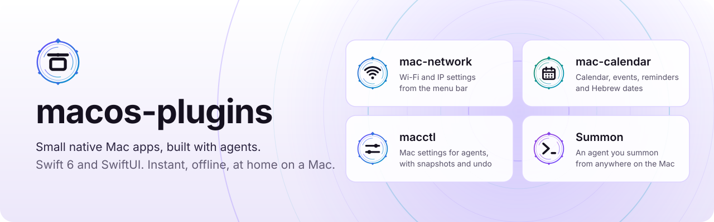
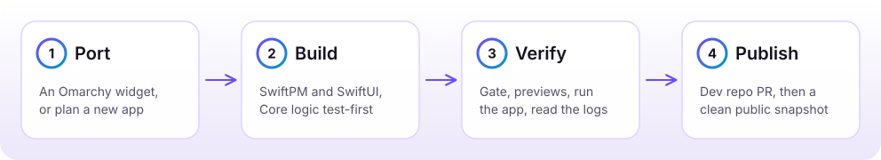

<p align="center">
  <picture>
    <source media="(prefers-color-scheme: dark)" srcset="docs/assets/hero-dark.svg">
    
  </picture>
</p>

<p align="center">
  <a href="https://github.com/RohiRIK/macos-plugins/actions/workflows/swift.yml"></a>
  
</p>

# macos-plugins

Private workspace for building small native macOS apps ("plugins"): menu bar extras, panels and
utilities, written in Swift 6 and SwiftUI. Many start as ports of Linux/Omarchy bar widgets. The bar is
real native apps that launch instantly, work offline and look like they belong on the Mac.

This repo holds the shared know-how, not the apps: agent skills, workspace tools, docs and plans. Each
plugin lives in its own pair of repos (private `<name>-dev` + public `<name>`), cloned into
`plugins/<name>/`, which is gitignored here.

## Projects

| | Project | What it is |
|---|---|---|
|  | **[mac-network](https://github.com/RohiRIK/mac-network)** | Wi-Fi and IP settings from the menu bar. Port of [`rohi.network`](https://github.com/RohiRIK/rohi.network). Shipped. |
|  | **[mac-calendar](https://github.com/RohiRIK/mac-calendar)** | Menu bar calendar with events, reminders and Hebrew dates. Shipped. |
|  | **[macctl](macctl/README.md)** | Command-line tool for agents to read, set, diff, apply and undo macOS settings, with snapshots. In this repo for now. |
|  | **[Summon](incubator/summon/README.md)** | The Omarchy experience on macOS: one agent you summon from anywhere, themes, tiling, app builders. Incubating. |

Every plugin, its repos and status: [`plugins.md`](plugins.md).

## How a plugin is made

<picture>
  <source media="(prefers-color-scheme: dark)" srcset="docs/assets/lifecycle-dark.svg">
  
</picture>

Each step names the skill or script that owns it: [docs/workflow.md](docs/workflow.md).

## What is here

| Path | What it is |
|---|---|
| [`AGENTS.md`](AGENTS.md) | Rules for agents and people: stack, workflow, conventions, publishing. `CLAUDE.md` points to it. |
| [`plugins.json`](plugins.json) | Plugin registry, the source of truth; [`plugins.md`](plugins.md) (index of every plugin, its repos and status) is generated from it |
| [`examples/`](examples) | `menubar-starter`, the skeleton `tools/mp new` copies |
| [`.claude/skills/`](.claude/skills) | Agent skills used by every plugin ([which one when](AGENTS.md#skills-which-one-when)) |
| [`tools/`](tools) | Workspace scripts: `mp` (plugin home), workspace check, publish, release, previews, Xcode MCP client, README art ([docs/tools.md](docs/tools.md)) |
| [`docs/`](docs) | [Plugin lifecycle](docs/workflow.md), [tools](docs/tools.md), [research notes](docs/research), [finished plans](docs/plans), [README art](docs/assets) |
| [`tasks/`](tasks) | `todo.md` (current plan only) and `lessons.md` (rules learned from corrections) |
| `.mcp.json` | Xcode MCP server (`xcrun mcpbridge`) for builds, tests and previews |

## Set up a Mac

1. Xcode (with the Xcode MCP bridge) selected via `xcode-select`, and `gh` signed in.
2. [Bun](https://bun.sh) and `jq`, for `tools/mp`, `tools/xcode-mcp.ts` and `tools/render-previews.sh`.
3. Clone this repo, then `tools/mp clone --all` clones each plugin's dev repo into `plugins/<name>/`.
4. Link the skills library: `.claude/skills/MacPluginPlaybook` is a per-machine symlink (gitignored).
5. Create `tools/private-patterns.txt` (gitignored): one regex per line for private values (email,
   home subnet, MAC addresses, hostnames). `tools/publish-public.sh` refuses to run without it, and
   `tools/record-demos.sh` uses it to scrub demo transcripts.

Build caches go to `~/Library/Caches/macplugins/<name>`, never `.build/` inside Google Drive.

## Stack in one line

Swift 6 + SwiftUI, SwiftPM only (no `.xcodeproj`), macOS 15+, swift-testing, no third-party
dependencies unless a skill says so. Details: [`AGENTS.md`](AGENTS.md#stack).

## README art

Every image in these READMEs is a committed file with a relative path; nothing is hosted elsewhere.

```sh
python3 tools/readme-art.py           # write docs/assets/*.svg (logos, banner, diagram, pill, terminal cards)
python3 tools/readme-art.py --check   # exit 1 if a committed SVG is stale
tools/record-demos.sh                 # on a Mac: re-record macctl's demo transcripts, cards and GIF
```

Colors and the ring mark are shared with Summon through `incubator/summon/design/brandkit.py`.

## License

Plugins are MIT. The vendored skills `swiftui-expert-skill` and `swift-concurrency-pro` are MIT and
keep their own `LICENSE` files.
