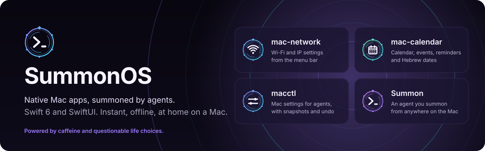
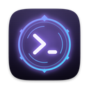

<p align="center">
  
</p>

<p align="center">
  <a href="https://github.com/RohiRIK/SummonOS/actions/workflows/swift.yml"></a>
  
</p>

# SummonOS: the agentic layer for the Mac

SummonOS sits on top of macOS and tells the coding agents you already use what is going on with your Mac.
It works with Claude Code, Codex, Cursor, OpenCode, Hermes, OpenClaw, Antigravity CLI and Pi. The idea is not
new: [Omarchy](https://omarchy.org) v4 calls itself "agentic Linux". SummonOS rebuilds that idea for the Mac,
as native Swift apps.

Here is what the Mac version adds:

- **Native Swift binaries.** `summon`, `macctl` and Summon.app have no dependencies, start instantly and
  work offline.
- **Live Mac context.** Every agent knows this Mac's state when a session starts, and can ask again at any
  time.
- **Undo for anything an agent changed.** Each session and each theme starts with a checkpoint, and one
  command or one panel row rolls it back.

It is a preview: parts work today and plenty does not. Read the [security and recovery model](docs/security-model.md)
before you let agents run unattended.

## What you get

Every item below is described command by command in [`docs/features.md`](docs/features.md).

- **`summon context`** gives agents one read-only snapshot of this Mac in about 60 ms. It covers the model and
  chip, power and thermal state, free disk space, network and VPN, displays, the frontmost app, appearance,
  permissions, installed agents and recent crashes.
- **`summon mcp` plus `summon connect`.** `summon mcp` is an MCP server with 11 tools: Mac context,
  macctl settings with snapshots and undo, checkpoints, crash reports and recent Mac changes. One `summon connect` registers it
  in every installed agent. It also adds a short "This Mac" note to each agent's instructions and, for Claude
  Code, Codex, Cursor and Antigravity CLI, a session-start hook that hands over the context.
- **⌃⌥⌘A starts your agent with what is on screen.** The agent receives the frontmost app and window, the
  selected text, the browser tab's URL and the files selected in Finder, then waits for your question.
- **Undo any agent's session.** Before an agent's first settings change over MCP, Summon takes a checkpoint
  labeled with the agent's name. To roll back, run `summon undo-session` or choose the panel's "Undo
  <Agent> Session (N changes)…" row.
- **Whole-Mac themes in one command.** `summon theme set <slug>` sets the wallpaper, accent color and
  dark or light mode. It also restyles Ghostty, kitty, window borders, Claude Code, VS Code, Cursor and
  Neovim. One `summon checkpoint undo <id>` reverts all of it, including the files the theme created.

## Install

On a Mac with macOS 15 or later:

```sh
curl -fsSL https://raw.githubusercontent.com/RohiRIK/SummonOS/main/install.sh | bash
```

This installs the newest [release](https://github.com/RohiRIK/SummonOS/releases), including prereleases, and
does not need Xcode. The installer checks the download against `SHA256SUMS`. It then puts `Summon.app` in
`~/Applications` and `summon` and `macctl` in `~/.local/bin`, and runs `summon doctor`. Run the same command
again to update. Your themes, projects and settings are kept.

Put options after `bash -s --`, for example `curl -fsSL …/install.sh | bash -s -- --connect`:

| Option | Does |
|---|---|
| `--from-source` | Build from source. Needs git and Swift 6 (Xcode or the Command Line Tools). |
| `--version vX.Y.Z` | Install that release. |
| `--connect` | Run `summon connect` after the install without asking. |
| `--yes` | Never prompt. It does not connect unless you also pass `--connect`. |

You can also let your agent install it. Paste this into Claude Code, Codex or any coding agent on your Mac:

```text
Install SummonOS by following https://raw.githubusercontent.com/RohiRIK/SummonOS/main/docs/install-ai.md
```

**About preview builds.** Releases are ad-hoc signed and not notarized. Two things follow from that:

- **Gatekeeper.** The curl installer does not mark the app as downloaded from the internet, so it opens
  normally. If you download the zip in a browser instead, macOS blocks the first launch. Allow it in System
  Settings › Privacy & Security.
- **Accessibility.** macOS can treat each update as a new app. If the selected text or window title stops
  reaching the agent, turn Summon's switch off and on again in System Settings › Privacy & Security ›
  Accessibility. Settings › General in Summon shows whether this is needed.

Then connect your agents. Preview the changes first; every file is backed up before it is edited:

```sh
summon connect --dry-run
summon connect
```

## 60-second tour

The output below is shortened.

```console
$ summon context
## This Mac (summon context, 2026-10-25 16:21)
- Mac: Mac16,7, Apple M4 Pro, 48 GB RAM, macOS 27.0.1, up 9.5 h
- Power: battery 100%, charging, thermal nominal
- Network: online via en0, VPN off
- Frontmost: Ghostty (com.mitchellh.ghostty)
- Agents: default claude; installed claude, codex, opencode
- Problems: no crashes or hangs in the last day

$ summon connect --dry-run
Claude Code      already-connected  summon is already in its MCP servers
Codex            would-connect  would run: codex mcp add summon -- ~/.local/bin/summon mcp
    would change ~/.codex/AGENTS.md
    would change ~/.codex/hooks.json
Cursor           not-installed  Cursor is not installed

$ summon theme set tokyo-night
Undo the whole look: summon checkpoint undo 20261025-153314

$ summon checkpoint undo --dry-run
macctl undo 20261025-153314 --json
...

$ summon agent prompt "Why is my Mac slow?"
```

The last command opens your default agent (`summon default agent claude`) in a terminal, already working on
the task. See `summon commands --json` for every command with its arguments and examples.

## Demos (coming)

<!-- Demo GIF 1: undo an agent's session from the panel row "Undo <Agent> Session (N changes)…". -->
<!-- Demo GIF 2: ⌃⌥⌘A with text selected in a browser; the agent's first message shows the app, page and selection. -->
<!-- Demo GIF 3: summon theme set <slug> restyles wallpaper, accent, terminal and editors; one undo reverts it. -->

Three short recordings will go here: undoing an agent's session, the hotkey with on-screen context, and a
whole-Mac theme.

## What is in the repo

| | Part | What it is |
|---|---|---|
|  | **[Summon](incubator/summon/README.md)** | The `summon` CLI, the MCP server, the menu bar app (panel on ⌃⌥Space, Activity window, checkpoints, crash alerts, recurring tasks), themes, and app templates |
|  | **[macctl](macctl/README.md)** | The settings CLI: read, set, diff, apply and undo macOS settings, with a snapshot before every change |
| | **[Menu bar apps](plugins.md)** | Apps built with SummonOS, each in its own repo: [mac-network](https://github.com/RohiRIK/mac-network), [mac-calendar](https://github.com/RohiRIK/mac-calendar), [mac-breathe](https://github.com/RohiRIK/mac-breathe), [end-of-day](https://github.com/RohiRIK/end-of-day) |
|  | **[Agent skills](.claude/skills)** | How agents plan, design, build and verify native Mac apps ([which one when](AGENTS.md#skills-which-one-when)) |

Everything, feature by feature: [`docs/features.md`](docs/features.md). Workspace scripts: [`docs/tools.md`](docs/tools.md).
How an app is made, step by step: [`docs/workflow.md`](docs/workflow.md).

## Status and roadmap

SummonOS is a preview (`0.1.0`). What is designed but not built yet is listed under "Planned" in
[`docs/features.md`](docs/features.md). Finished and long-running plans are in [`docs/plans/`](docs/plans/index.md).
While Summon.app runs it logs Mac changes for agents (network, VPN, low disk, battery, thermal, displays):
`summon events --kind mac --follow` or the MCP tool `mac_events`.

- **Security:** [`docs/security-model.md`](docs/security-model.md) describes what agents may do and what undo can
  and cannot restore. Report problems privately through [`SECURITY.md`](SECURITY.md).
- **Contributing:** issues and pull requests are welcome, from people and from agents. Start with
  [`CONTRIBUTING.md`](CONTRIBUTING.md). Agents follow [`AGENTS.md`](AGENTS.md).

```sh
git clone https://github.com/RohiRIK/SummonOS && cd SummonOS
./install.sh                     # builds and installs this checkout
tools/check-workspace.sh         # the checks a pull request must pass
```

<details>
<summary><b>Maintainer setup</b> (publishing apps to their own repos)</summary>

Each workspace app lives in its own pair of repos (private `<name>-dev` + public `<name>`), cloned into
`plugins/<name>/`, which is gitignored here.

1. Xcode (with the Xcode MCP bridge, `.mcp.json`) selected via `xcode-select`, and `gh` signed in.
2. [Bun](https://bun.sh) and `jq`, for `tools/mp`, `tools/xcode-mcp.ts` and `tools/render-previews.sh`.
3. `tools/mp clone --all` clones each app's dev repo into `plugins/<name>/`.
4. Optional: `.claude/skills/MacPluginPlaybook` is a per-machine symlink to a private skills library (gitignored).
5. Create `tools/private-patterns.txt` (gitignored): one regex per line for private values (email,
   home subnet, MAC addresses, hostnames). `tools/publish-public.sh` refuses to run without it, and
   `tools/record-demos.sh` uses it to scrub demo transcripts.

Build caches go to `~/Library/Caches/macplugins/<name>`, never `.build/` inside a synced folder.

The art in `docs/assets/` is generated by `python3 tools/readme-art.py` (`--check` exits 1 if a committed SVG is
stale).

</details>

## License and credits

[MIT](LICENSE). The idea of an agent-centered desktop comes from [Omarchy](https://omarchy.org); the story is at
[rohi-lab.org/blog/omarchy](https://rohi-lab.org/blog/omarchy). Community theme palettes and adapted skill
structure are credited in [`incubator/summon/THIRD_PARTY_NOTICES.md`](incubator/summon/THIRD_PARTY_NOTICES.md).
The vendored skills `swiftui-expert-skill` and `swift-concurrency-pro` are MIT and keep their own `LICENSE` files.
