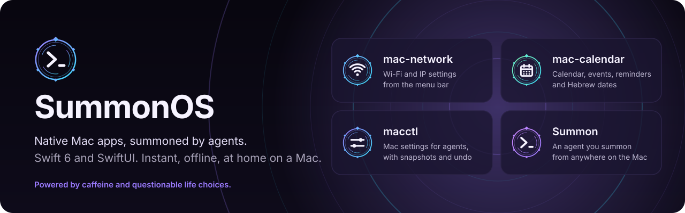

<p align="center">
  
</p>

<p align="center">
  <a href="https://github.com/RohiRIK/SummonOS/actions/workflows/swift.yml"></a>
  <a href="https://github.com/RohiRIK/SummonOS/releases"></a>
  
</p>

# SummonOS: the agentic layer for the Mac

SummonOS gives coding agents live Mac context, a native menu bar interface, and recoverable changes to supported
macOS settings. It works with the agents you already use; it does not replace or sandbox them.

**[Documentation and wiki](docs/home.md)** · **[Get started](docs/getting-started.md)** ·
**[Features](docs/features.md)** · **[Troubleshooting](docs/troubleshooting.md)** · **[Status](docs/status.md)**

SummonOS is a preview, not a production-qualified recovery system. The latest numbered release checked for this
documentation is **v0.2.5**, published as a prerelease on November 11, 2026; see [status and verification limits](docs/status.md).

## What it does

- **Live context:** `summon context` reports hardware, power, storage, network, displays, appearance, permissions,
  running apps, installed agents and recent crashes. Choose which sensitive fields agents receive.
- **Agent integration:** `summon connect` installs supported MCP registrations, instruction blocks and session
  hooks. `summon mcp` exposes read tools and journaled settings/checkpoint actions to connected agents.
- **Ask from anywhere:** ⌃⌥⌘A opens your default agent with the frontmost app, window and permitted selection,
  browser and Finder context. ⌃⌥Space opens the searchable Summon panel.
- **Settings recovery:** macctl snapshots supported changes; Summon checkpoints combine those settings with
  successfully captured configuration. Undo is not a backup of arbitrary files or external actions.
- **Whole-Mac themes:** one command coordinates wallpaper, appearance, native accent, terminal and supported
  editor configuration. Theme application records a checkpoint and tracks the files it creates for undo.
- **Native app tools:** private local projects, nine starter templates, scheduled tasks, crash diagnosis, an
  Activity window, an Updates window, and Siri/Shortcuts actions.

The [feature reference](docs/features.md) describes the exact scope. Read the
[security and recovery model](docs/security-model.md) before granting unattended agent execution.

## Install

On macOS 15 or newer:

```sh
curl -fsSL https://raw.githubusercontent.com/RohiRIK/SummonOS/main/install.sh | bash
```

The remote installer downloads the newest numbered release, including previews but excluding the rolling
`edge` release, verifies `SHA256SUMS` and signed GitHub build provenance, and installs `Summon.app` in `~/Applications` and the commands in
`~/.local/bin`. A packaged release needs no Xcode. If no release can be selected, the installer attempts a
source build, which requires Git and Swift 6; current staging also uses Python 3. Xcode supplies App Intents metadata.

Downloaded installs and updates from this checkout require a recent **GitHub CLI (`gh`)** with
`gh attestation verify` support and GitHub API access. Install it with your package manager (for example,
`brew install gh`) and authenticate with `gh auth login` if needed. Verification requires this repository's
release workflow on GitHub-hosted runners and the requested tag (or `main` for edge). Missing/invalid provenance
or a failed verifier stops before unpacking; there is no unverified-release fallback. Published older updaters
do not gain this check retroactively. See the [distribution trust boundary](docs/security-model.md#distribution).

Preview builds are ad-hoc signed and not notarized. Browser-downloaded archives may need **System Settings ›
Privacy & Security › Open Anyway**. Accessibility can need reauthorization after an update.

```sh
summon doctor
summon connect --dry-run
summon connect
open "$HOME/Applications/Summon.app"
```

Connecting changes agent configuration and instructions; review the dry run first. Files are backed up.
To let an agent install SummonOS, give it the [installation playbook](docs/install-ai.md).

### Update

```sh
summon update --check
summon update
```

Self-update starts with 0.2.0. In 0.2.0 the panel's update row was broken: use the CLI once; 0.2.1 fixes that
row. Current builds use a dedicated Updates window. On 0.1.x, rerun the installer. Themes, projects and
settings are preserved. [Installation options and channels](docs/getting-started.md#installation-options)
cover pinned versions, opt-in edge builds and source checkouts.

## Try it

```sh
summon context                         # read this Mac's context
summon agents                          # discover agents and installation methods
summon default agent claude             # choose an installed agent
summon panel                           # open the native searchable panel
summon agent prompt "Explain this project"
summon checkpoint list                 # inspect recovery points
summon commands --json                 # machine-readable command catalog
```

Agent prompts can start an agent that runs commands. Review the execution policy in **Settings › General**;
new installations use the agent's own approval controls. No command above is a claim that arbitrary agent
work can be rolled back.

## Project map

| Part | Purpose | Documentation |
|---|---|---|
| Summon | `summon` CLI, MCP server and native menu bar app | [Overview](incubator/summon/README.md), [changelog](incubator/summon/CHANGELOG.md) |
| macctl | Read, set, diff, apply and undo declared macOS settings | [CLI guide](macctl/README.md), [settings catalog](macctl/docs/settings.md) |
| Plugins | Independently published native apps | [Generated registry](plugins.md) |
| Workspace | Templates, skills, build and publishing tools | [Tools](docs/tools.md), [app lifecycle](docs/workflow.md) |
| Wiki | User guides, reference, design research and historical plans | [Start here](docs/home.md), [complete docs index](docs/index.md) |

Plugin implementations are separate repositories; the registry records their status, not a fresh audit of
those apps. Summon-created apps live privately in `~/Summon/Apps`, not in the workspace registry.

## Build and contribute

```sh
git clone https://github.com/RohiRIK/SummonOS
cd SummonOS
./install.sh                    # builds and installs this checkout, not the latest release
tools/check-workspace.sh        # workspace hygiene and generated documentation indexes
```

Use selected Xcode with Swift 6 for the full build/test flow and Siri/Shortcuts metadata. The bundler can omit
those actions with Command Line Tools alone. Build caches belong in `~/Library/Caches/macplugins`, outside the
synced checkout. The widget template has a small Xcode project
for its extension; the rest of the app/template packages use SwiftPM.

See [Contributing](CONTRIBUTING.md) for targeted tests and CI, [documentation maintenance](docs/documentation.md)
for the wiki build/preview, and [Security](SECURITY.md) for private vulnerability reporting. Agents follow
[`AGENTS.md`](AGENTS.md).

<details>
<summary>Maintainer setup: plugin repositories and publication</summary>

Workspace plugins use private `<name>-dev` repositories for full development history and public `<name>`
repositories for clean snapshots. `tools/mp clone --all` populates the gitignored `plugins/` directory.

- Select Xcode and authenticate `gh`.
- Install Bun and `jq` for workspace/Xcode MCP tooling.
- Configure the gitignored `tools/private-patterns.txt` before publication or demo recording.
- `tools/publish-public.sh` scans snapshots before publishing; never make a dev repository public.
- README art is generated by `python3 tools/readme-art.py`; use `--check` to detect stale artwork.

Publishing an application release and deploying the wiki to Vercel are separate maintainer actions.
The documentation domain is [sumonos.rohi-lab.org](https://sumonos.rohi-lab.org/).

</details>

## License and credits

[MIT](LICENSE). Omarchy is research and inspiration for an agent-centered desktop, not a source to copy
wholesale: [background](https://rohi-lab.org/blog/omarchy). Community palettes and adapted material are credited
in [third-party notices](incubator/summon/THIRD_PARTY_NOTICES.md). Vendored SwiftUI/concurrency skills retain
their MIT licenses.
