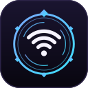
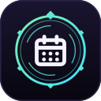
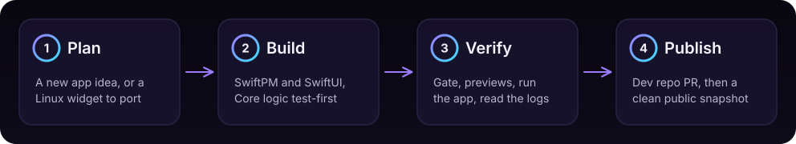

<p align="center">
  
</p>

<p align="center">
  
</p>

# SummonOS

*Powered by caffeine and questionable life choices.*

## Install

On a Mac with macOS 15+ and Xcode (or the Command Line Tools) with Swift 6:

```sh
curl -fsSL https://raw.githubusercontent.com/RohiRIK/SummonOS/main/install.sh | bash
```

Or let your agent do it. Paste this into Claude Code, Codex or any coding agent on your Mac:

```text
Install SummonOS by following https://raw.githubusercontent.com/RohiRIK/SummonOS/main/docs/install-ai.md
```

The installer builds Summon and macctl from source, puts `Summon.app` in `~/Applications` and `summon` and
`macctl` in `~/.local/bin`, then runs `summon doctor`. Run it again to update.

## What it is

SummonOS turns a Mac into a place where agents build and run native apps. At its center is
[Summon](incubator/summon/README.md), one coding agent you summon from anywhere on the Mac; around it are
[macctl](macctl/README.md) for system settings and a growing set of small native apps ("plugins"): menu bar
extras, panels and utilities, written in Swift 6 and SwiftUI.
The bar is real native apps that launch instantly, work offline and look like they belong on the Mac.
Everything each project can do today: [`docs/features.md`](docs/features.md).

This repo is the SummonOS workspace. It holds Summon and macctl while they incubate, plus the shared
know-how for the other apps: agent skills, workspace tools, docs and plans. Each
plugin lives in its own pair of repos (private `<name>-dev` + public `<name>`), cloned into
`plugins/<name>/`, which is gitignored here.

## Projects

| | Project | What it is |
|---|---|---|
|  | **[mac-network](https://github.com/RohiRIK/mac-network)** | Wi-Fi and IP settings from the menu bar. Port of [`rohi.network`](https://github.com/RohiRIK/rohi.network). Shipped. |
|  | **[mac-calendar](https://github.com/RohiRIK/mac-calendar)** | Menu bar calendar with events, reminders and Hebrew dates. Shipped. |
|  | **[macctl](macctl/README.md)** | Command-line tool for agents to read, set, diff, apply and undo macOS settings, with snapshots. Tested on a Mac; in this repo for now. |
|  | **[Summon](incubator/summon/README.md)** | One coding agent you summon from anywhere on the Mac. It gets crashes handed to it, checkpoints before it works, and builds apps from templates. Incubating. |

Every plugin, its repos and status: [`plugins.md`](plugins.md).

## Built with SummonOS

Real apps, each in its own repo, built by agents with these skills and Summon's templates.

| | App | What it does |
|---|---|---|
|  | **[mac-breathe](https://github.com/RohiRIK/mac-breathe)** | A breathing guide: a soft orb grows and shrinks with your breath, from the menu bar or as a full-screen focus window. |
|  | **[mac-calendar](https://github.com/RohiRIK/mac-calendar)** | Menu bar calendar with your events, reminders, natural-language Add Event and Hebrew dates. |
|  | **[mac-network](https://github.com/RohiRIK/mac-network)** | Wi-Fi, latency, throughput and IP settings from the menu bar. |
|  | **[end-of-day](https://github.com/RohiRIK/end-of-day)** | Closes your work apps when the workday ends: a schedule, a 30-second countdown you can snooze, and a streak. Made with `summon project new`. |

## Why

I spent a while living in [Omarchy](https://omarchy.org) on Linux, where the whole desktop is one opinionated,
keyboard-first experience you can reshape in minutes. SummonOS asks what that feels like on a Mac when the
center of the experience is an agent: one you summon from anywhere, that gets your crashes, undoes what it
did, and builds the small tools you need. It is an idea in progress, not a finished product. More on how it
started: [rohi-lab.org/blog/omarchy](https://rohi-lab.org/blog/omarchy).

## Work on it

```sh
git clone https://github.com/RohiRIK/SummonOS && cd SummonOS
./install.sh          # builds and installs this checkout
```

Then read [`AGENTS.md`](AGENTS.md) for the rules and [`docs/workflow.md`](docs/workflow.md) for how a
new app goes from idea to release (and [which path](docs/workflow.md#which-path) to start it on).

## How an app is made



Each step names the skill or script that owns it: [docs/workflow.md](docs/workflow.md).

## What is here

| Path | What it is |
|---|---|
| [`install.sh`](install.sh) | The one-line installer (Summon + macctl); agents use [`docs/install-ai.md`](docs/install-ai.md) |
| [`AGENTS.md`](AGENTS.md) | Rules for agents and people: stack, workflow, conventions, publishing. `CLAUDE.md` points to it. |
| [`plugins.json`](plugins.json) | Plugin registry, the source of truth; [`plugins.md`](plugins.md) (index of every plugin, its repos and status) is generated from it |
| [`examples/`](examples) | `menubar-starter`, the skeleton `tools/mp new` copies (Summon's own templates are in `incubator/summon/templates/`) |
| [`.claude/skills/`](.claude/skills) | Agent skills used by every plugin ([which one when](AGENTS.md#skills-which-one-when)) |
| [`tools/`](tools) | Workspace scripts: `mp` (plugin home), workspace check, publish, release, previews, Xcode MCP client, README art ([docs/tools.md](docs/tools.md)) |
| [`docs/`](docs) | [Features](docs/features.md), [plugin lifecycle](docs/workflow.md), [tools](docs/tools.md), [research notes](docs/research), [plans](docs/plans/README.md), [README art](docs/assets) |
| [`tasks/`](tasks) | `todo.md` (current plan only) and `lessons.md` (rules learned from corrections) |
| `.mcp.json` | Xcode MCP server (`xcrun mcpbridge`) for builds, tests and previews |

## Set up a Mac

1. Xcode (with the Xcode MCP bridge) selected via `xcode-select`, and `gh` signed in.
2. [Bun](https://bun.sh) and `jq`, for `tools/mp`, `tools/xcode-mcp.ts` and `tools/render-previews.sh`.
3. Clone this repo, then `tools/mp clone --all` clones each plugin's dev repo into `plugins/<name>/`.
4. Link the skills library: `.claude/skills/MacPluginPlaybook` is a per-machine symlink (gitignored).
5. Create `tools/private-patterns.txt` (gitignored): one regex per line for private values (email,
   home subnet, MAC addresses, hostnames). `tools/publish-public.sh` refuses to run without it, and
   `tools/record-demos.sh` uses it to scrub demo transcripts.

Build caches go to `~/Library/Caches/macplugins/<name>`, never `.build/` inside Google Drive.

## Stack in one line

Swift 6 + SwiftUI, SwiftPM only (no `.xcodeproj`), macOS 15+, swift-testing, no third-party
dependencies unless a skill says so. Details: [`AGENTS.md`](AGENTS.md#stack).

## README art

Every image in these READMEs is a committed file with a relative path, so it renders on GitHub with nothing hosted elsewhere.

```sh
python3 tools/readme-art.py           # write docs/assets/*.svg (SummonOS hero and wordmark, diagram, icons, pill, terminal cards)
python3 tools/readme-art.py --check   # exit 1 if a committed SVG is stale
tools/record-demos.sh                 # on a Mac: re-record macctl's demo transcripts, cards and GIF
```

SummonOS uses Summon's ring mark and colors, shared through `incubator/summon/design/brandkit.py`;
Summon's PNG icon, banner and wordmark are made by `incubator/summon/design/generate.py`.

## License

[MIT](LICENSE), as are the plugins. The vendored skills `swiftui-expert-skill` and `swift-concurrency-pro` are MIT and
keep their own `LICENSE` files.
