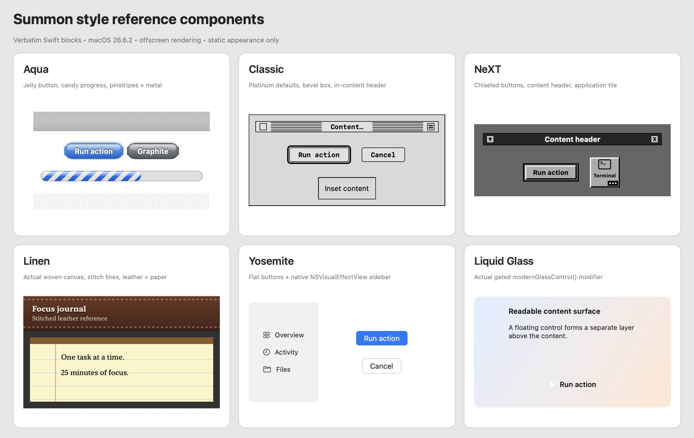

# Design skills and public preview

The owner authorized retesting the new skills, pushing all reviewed workspace changes, making
`RohiRIK/SummonOS` public, and verifying GitHub CI. This publishes an experimental source project;
[production qualification](2026-10-20-production-readiness.md) still has real-device release gates.

## Skill repairs

- Six entrypoints: LiquidGlass, MacAqua, MacClassic, MacLinen, MacNeXT, MacYosemite.
  Added concise metadata, mutually distinguished triggers, progressive references, gotchas, and examples.
- Preserved era direction while labeling illustrative palettes as approximations. Kept native window
  controls and real callbacks. Repaired progress bounds/animation, linen layout, Yosemite appearance,
  and the NeXT tile running badge so it no longer covers the label.
- LiquidGlass examples are complete Swift units, with macOS 26 availability checks and macOS 15 fallbacks.
  A single Settings section can use a grouped Form; sidebar navigation fits multiple sections.

## Verification

| Check | Result |
|---|---|
| Structural gate | All six skills pass metadata, routes, contained references, and fence checks |
| Swift examples | Eight files typechecked, Swift 6 / macOS 15 deployment target, Xcode 27 on Apple Silicon |
| Checker regressions | 19 tests pass, including missing/escaping references and compiler failures |
| Model selection | Eight requests selected the expected modern, five retro, no-design, or mixed skills |
| Controlled comparison | Two requests answered by separate baseline/guided agents: a six-style sampler and Aqua focus timer with modern Settings |
| Guided output | Composed with the referenced components; first Swift 6/macOS 15 typecheck passed without repairs |
| Baseline output | Comparable representative composition failed on an invalid `accessibilityContrast` environment key |
| Static visual check | Native offscreen contact sheet inspected; caught and corrected the NeXT badge overlap |
| Project verification | Summon full gate (175 Core + 5 CLI tests and release bundle); macctl 94 tests; 45 distribution fixtures pass |

Both comparison responses preserved native chrome and separated Settings from the panel. The guided
response reused the supplied components. These two requests and eight selection cases are small,
controlled checks, not a statistical reliability claim or proof of automatic discovery in every agent.
Temporary response transcripts were kept outside the repository.

The contact sheet is a static light-mode capture on macOS 26.6.2. An unordered window does not reproduce
compositor Liquid Glass or active behind-window vibrancy: those cells establish type/layout checks,
not final live effects. Keyboard, VoiceOver, dark mode, macOS 15 runtime, login registration, and live
window activation were not exercised by this skill test. No live preferences or login items changed.

## Publication review

Generic Gitleaks scans found zero findings in reachable history and the intended tree. Targeted review
covered 162 historical commit trees, 1,000 blobs, image metadata, SVG active content, and four screenshots.
No private plugin repositories, scratch apps, build caches, secrets, or real network fixture data are
included. Historical worktree gitlinks contain IDs, not nested repository contents. The owner's
existing commit identity remains in history under the workspace's documented policy.

`tools/private-patterns.txt` is absent, so owner-specific pattern coverage was unavailable; this is a
coverage limit, not evidence that a private value was found. All ten provider icon files exactly match
a pinned MIT CodexBar revision; source and full license are recorded in Summon's third-party notices.

## CI and handoff

The public workflow checks workspace/docs/skill structure and isolated tooling regressions on Linux,
typechecks skill examples on macOS, and builds/tests all seven Swift packages on macOS. Action versions
are pinned and token permissions are read-only. Local fixture tests do not use real signing credentials
or publish binaries. Repository visibility, public installer access, PR checks, and final merge results
are recorded below after live verification.

### Hosted-runner cache correction

The first live run passed workspace and design-skill checks, then exposed compiled SwiftShims modules
restored from the workspace's former repository path. Those modules are not relocatable. CI now caches
only dependency source repositories/checkouts/artifacts under a new key namespace, rebuilding compiler
outputs for each checkout/toolchain. The failure was observed on GitHub, not inferred from local tests.

- Repository visibility is PUBLIC; anonymous repository, installer, and agent install-guide requests return HTTP 200.
- Review: [PR #60](https://github.com/RohiRIK/SummonOS/pull/60). Final live checks are pending.
