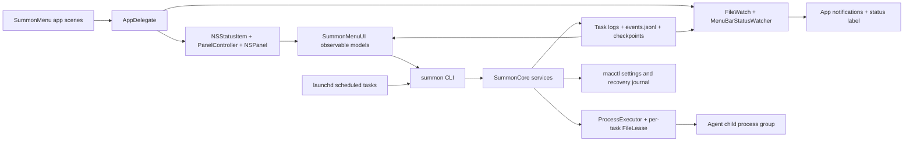

# Summon runtime audit and implementation roadmap

## Scope and conclusion

Audited source: `3f37adf556b1`, SummonOS `0.2.4`. This deliverable is an audit and implementation plan; application code and shipping scripts were not changed.

**Prioritize completion correctness and main-actor work before an architectural rewrite.** The audit found concrete mechanisms for missing completion results and incorrectly removed logs, plus synchronous work precisely when commands return. It did **not** establish the cause of an application crash or prove a memory leak. Those are different claims.

Explicit requirements:

- A dedicated About surface with version and build details.
- A measured roadmap for menu rendering, state management and memory efficiency.
- Investigation of post-completion failures, leaks and unhandled states.
- Specific automation for build, deployment, validation and post-execution cleanup.

Scope decisions:

- “Main application” means `incubator/summon`: the registry identifies Summon as the application with the menu UI. `macctl` is its settings CLI dependency.
- The registered `plugins/*` repositories were not present in this checkout; their implementations are not audited here. Shared workspace tooling and Summon's template/build conventions were inspected, not every template's behavior.
- `PanelActions.finish` means **dismiss the panel**, not finish an agent task. Scheduled execution finishes through `TaskCommands.runTask`; command-triggered menu actions finish through `SummonModel.summon` / `run`.
- Keep the existing nonactivating panel, separate Settings window, SwiftPM targets, Swift 6 concurrency and macOS 15 minimum. No new package dependency, database or replacement UI architecture is justified.

## Architecture overview



Existing strengths worth preserving:

- `Package.swift:8–20`: thin `SummonMenu` executable, previewable `SummonMenuUI` library, shared `SummonCore`, separate CLI and Core/CLI test targets.
- `ProcessExecutor.swift:29–41,57–124,159–194`: execution off the main actor, bounded output/log retention, cancellation propagation, process groups, parent reaping and descriptor cleanup. Scheduled runs also terminate remaining same-group descendants on normal exit.
- `StatusPanel.swift:420–437,461–498`: close removes per-open observers and restores focus according to the existing dismissal policy. The panel's persistent hosting view is intentional reuse, not itself a leak.
- `MenuBarStatusWatcher.swift:29–55`: filesystem-driven status wakeups; one-second ticks only when an agent clock is displayed. `SummonModel.startWatching` already uses a slow, tolerant maintenance loop. Do not propose “replace constant polling” as if this work did not exist.
- `scripts/install.sh:16–107`: install lock, staging, signature verification, backups and rollback already exist. Release workflows already provide universal builds, checksums, attestations and optional notarization.

Source paths without a workspace prefix below are relative to `incubator/summon/`.

## Evidence collected

### Current-source microbenchmark

A throwaway Swift executable compiled the **actual current `Sources/SummonCore/*.swift`**, using `swiftc -O -swift-version 6 -parse-as-library`. Fixtures were confined to a temporary directory. Each event-read case used one warm-up and 30 measured complete reads; p95 is the nearest-rank 95th percentile. Synthetic rows contained a timestamp, task result, title and task reference. All files were below the normal 1,000,000-byte trim threshold.

| Event rows | File bytes | Median complete read, ms | p95 complete read, ms |
|---:|---:|---:|---:|
| 100 | 10,490 | 0.756 | 0.859 |
| 2,000 | 212,890 | 7.646 | 8.945 |
| 6,000 | 640,890 | 22.935 | 23.521 |

This measures `EventLog.read`, not first-frame time or an entire model reload. Nevertheless, the synchronous UI reload invokes this reader and then invokes `ActivitySources.load`, which reads it again. A valid retained log alone can therefore consume meaningful main-thread time. `keep = 2,000` is a trim target, **not** an always-enforced row cap (`EventLog.swift:46–51,98–111`).

### Runtime scenarios actually exercised

- 50 short successful shell executions: correct captured output and log contents; open descriptor count in descriptor slots 0–1023 stayed **3 → 3**, after warm-up.
- Nonzero child: returned status **7** with its output.
- Missing executable: spawn failure caught.
- 80 ms executor deadline: timeout caught after **96.463 ms** in this run.
- Cancellation of a running shell/sleep invocation: `CancellationError` caught.
- Cleaner plan over 21 UUID-shaped log names with explicit modification times: **the newest log was selected for Trash**. Only planning ran; `SummonCleaner.apply` was not called.
- A `task.done` event with a 70,000-byte detail: **append rejected**, establishing the completion-summary/event-limit mismatch.

These are source-level runtime checks, not a full scheduled-task/agent/Notification Center end-to-end run. They do not prove every descendant was reaped or every resource is leak-free. No real agent was invoked and no launchd job was installed.

### Existing installed application sample

The already-running app identified itself as version `0.2.4`, bundle build `1`. One `vmmap -summary` sample reported physical footprint **91.3M**, peak **100.0M**. One `ps` sample reported RSS **183,200 KiB** and CPU **2.2%**.

These are uncontrolled observations, not idle targets, growth measurements, or evidence that the installed binary matches the audited commit. RSS and physical footprint are different metrics. The app was not restarted or driven through a finish cycle.

`leaks` reported zero leaks but explicitly warned that the process was not debuggable and inspection was restricted to read-only memory. **This does not exclude leaks.** No `Summon*` diagnostic report matched in the user or system DiagnosticReports locations checked. A correlated crash report, hang sample or controlled finish trace is still needed to attribute a crash/hang to a particular cause.

### Verification limits

- No controlled panel-open, first-frame, search-frame, energy, long-run heap or close/reopen measurement yet.
- No UI was changed; no visual verification or full build/test-suite pass is claimed.
- The local toolchain was available: selected Xcode 27.1.0, Swift 6.4, arm64 host. Older context notes claiming Xcode was unavailable are not current evidence.
- Existing tests were inspected for coverage; they were not run as part of this investigation.

## Findings and root-cause analysis

### F1 — Completion can succeed while its terminal event disappears — P1

**Confirmed mechanism; event-size rejection exercised.** `TaskCommands.swift:220–244` reads the whole log and copies the last three **lines**, without a byte bound. Logs can reach roughly 5 MiB. `EventLog.swift:74–76` rejects an encoded event over 64 KiB. `ActivityCommands.swift:145–152` catches the write error; the task continues to notify/print success.

A long final line can therefore produce “Done” without a persisted `task.done`. If the app is running, `TaskCommands.notify` suppresses the CLI banner because the app is expected to consume the missing event. Result: stale task status and no completion notification.

**Change:** a bounded UTF-8 tail reader and a task-specific finalization result. Keep full output in the log; constrain the entire encoded event, including escaped characters and references. Report “execution succeeded; result persistence failed” distinctly. Do not rerun a successful agent to repair logging.

Do not merely make `ActivityCommands.record` throw inside the existing success/failure catch. `EventLog.append` writes before trimming (`:84–85`); a subsequent trim error must not turn a recorded success into a contradictory failure. Separate append failure from retention-maintenance failure.

### F2 — Cleanup can select a new or active run log — P1

**Wrong retention order exercised; active-run consequence is [INFERENCE].** `TaskCommands.swift:214` uses UUID filenames; `SummonCleaner.swift:40–46` sorts filenames descending to choose the “newest 20.” UUID order is unrelated to completion time.

`SummonCleaner.apply:85–96` does not acquire the task run lease or revalidate activity. Concurrent cleanup can move an open log while the child keeps writing through its descriptor; completion and Show Log then reference the old path. This explains a plausible missing-log symptom, not a demonstrated application crash. Automatic cleanup runs at app launch (`AppDelegate.swift:98–103`), not as a current per-task completion hook.

**Change:** sort by actual file time with a deterministic filename tie-breaker; take the existing per-task lease nonblocking before applying task-log cleanup, skip active tasks, and revalidate the plan under the lease. Apply the same protection to removed-task folders that may still have a manual run. Keep Trash/recovery semantics; surface partial failures instead of silently marking everything clean.

### F3 — Main-actor reload is on the command-completion path — P1

**Static execution path confirmed; whole-path stall not measured.** `SummonModel` is `@MainActor`; `summon:580–591` and `run:975–984` call synchronous `reload()` after the command returns.

`reload:229–266` loads settings, checks executables, enumerates themes/tasks, decodes the event log, scans activity sources, inspects project/theme/art health and rebuilds menus. `reloadProjects:669–673` already calls `loadMenu`, and the caller calls it again. `ActivitySources.load:347–364` rereads the event log and scans snapshot/checkpoint collections. `CrashWatcher.reports:310–315` enumerates/sorts diagnostics even with `limit: 0`, because the limit check is inside the loop.

Separately, `SummonModel.checkMac:478–485` appends events on the main actor; `FileLease.acquireSync:22–27` can block that actor for up to five seconds under contention.

**Change order:** remove duplicate reads/menu builds and zero-limit enumeration first; move blocking collection/write work off the main actor; publish an immutable snapshot on the main actor, preserving last-good state and visible errors. Do not move AppKit/permission APIs off their required actor. Optimize actual expensive subtrees only after trace evidence.

### F4 — Finish-time memory amplification is bounded, but avoidable — P2

**Static allocation path, not a proven leak.** `TaskCommands.runLogged:233–239` consumes only the returned status but leaves `maxOutputBytes` at 16 MiB. `ProcessExecutor.swift:131–154,189` retains output and builds a string while also streaming a separate log. Then `lastLines` loads/splits the log again.

**Change:** scheduled logged runs retain no redundant output buffer (`maxOutputBytes = 0`) when their error/result contract uses the log; bounded tail extraction supplies summaries. Check timeout/error consumers before changing options. Preserve output capture for other `Runner` consumers. Use buffer slices rather than an extra `Data` allocation per written log chunk if profiling shows it matters.

### F5 — Notification delivery can prolong a completed run's lease — P2

**Ordering confirmed; slow notification is [INFERENCE].** The per-task lease spans `runTask:181–228`. After the child exits and the event is written, `notify:250–255` may await `osascript`, using the default 60-second runner timeout. A completed task can remain busy to the next invocation during this ancillary work.

**Change:** complete log/result persistence, leave the lease scope, then perform best-effort notification with a short explicit deadline. Do not fire-and-forget from a CLI that immediately calls `exit`. A notification failure must not change the execution outcome or emit another terminal event. Observe Notification Center submission errors rather than discarding them (`AppDelegate.swift:290–291`).

### F6 — Event identity and task-state projection lose distinctions — P2

**Static defects; delivery races are [INFERENCE].** `EventAnnouncer.swift:59–63` keys a notification by kind/task/whole second, so different same-task, same-outcome runs in one second collide. `MenuBarStatusWatcher.swift:90–95` consumes by timestamp high-water mark, which can miss an older-timestamp event appended after a newer one. Timestamps are assigned before the append lease is acquired.

`TaskCommands.list:114–118` and `SummonModel.reload:253–256` treat any task-referenced event other than `task.failed` as “done.” Several identifiable-run preflight failures precede the terminal-event catch. A prior success can remain the apparent latest result.

**Change:** use the existing unique run-log UUID as the run identity, assign it before preflight, and carry it through terminal records and notifications. Filter explicitly to terminal event kinds; use an explicit outcome for success, failure, cancellation, timeout and interrupted execution. Keep execution outcome separate from persistence/notification errors. Track appended records by file identity/offset with a bounded identity set for rotation, rather than timestamps alone. Persist a minimal active-run marker only as needed for interrupted-run recovery; no new general-purpose workflow engine.

Existing logs must remain readable. A record without the new run reference can derive identity from its existing unique file reference; records with neither identity need deterministic legacy handling. New writers use only the new contract, and every CLI/menu/notification consumer migrates together.

### F7 — Cancellation and refresh completion can publish stale state — P2

**Static race conditions; UI manifestation unmeasured.** `ActivityModel.refresh:124–134` returns immediately when another refresh is loading. `PanelView.swift:88–91` nevertheless marks that open session refreshed. A cancelled panel task also awaits detached work that does not inherit cancellation and can still publish after close/reopen. Activity and panel have overlapping refresh loops (`ActivityModel:172–179`; `PanelView:79–92`).

`SummonModel.evaluateGuards:954–961` has no cancellation/generation check after awaiting a command; cancellation becomes `false` in `succeeds:988–994` and can overwrite newer guard state. The guard tasks are keyed to level/query/session, not panel visibility (`PanelView:72–78`).

**Change:** coalesce callers onto the actual in-flight refresh, return a snapshot/generation acknowledgement, and mark freshness only after that generation publishes. After every suspension, check cancellation and the expected session/query before publishing. Retain/cancel the underlying worker where appropriate; do not assume `Task.detached` inherits cancellation. Stop guard work on close and avoid starting further commands from a cancelled loop.

`MenuBarStatusWatcher` has a stop method that wakes its continuation; `SummonModel` also has stop methods, but `AppDelegate` does not wire termination to them. Add explicit stop ownership and cancellation-safe wait behavior for teardown/restart tests. Long-lived app-owned watchers are not automatically leaks; investigate retain graphs before claiming one.

### F8 — A newly created event log may not be watched promptly — P2

**Static latency window.** `MenuBarStatusWatcher.watchLog:52–55` only watches the file. If it does not exist when the loop starts, there is no creation notification; the non-ticking loop retries on the 60-second fallback with tolerance (`:35–40`). Atomic replacement also needs rearming against the current file.

**Change:** watch the containing state directory for creation/replacement and rearm the file watcher; invalidate by file identity and size as well as modification time. Keep the slow fallback for recovery. Verify initial creation, append, rename/trim, delete/recreate and out-of-order writer timestamps.

### F9 — About/build identity is incomplete — P2

**Confirmed gap.** `SummonMenuApp.swift:14–56` declares Activity, opener, onboarding, Updates and Settings scenes, but no dedicated About surface. Settings only shows `SummonVersion.current` within Updates (`SettingsView.swift:354–374`). `Resources/Info.plist:10–11` has version `0.2.4` and fixed build `1`.

The workspace checks base-version literals (`tools/check-workspace.sh:79–86`), but `.github/workflows/release.yml:70–75` stamps an edge suffix only into `SummonCore/Version.swift`. Bundle identity cannot identify that edge commit/build, even though its base marketing version may intentionally remain `0.2.4`.

**Change:** one generated build identity, a native About dialog reachable from Settings → General → About Summon, and the same action in the app's standard About command when a regular app menu is present. Keep the panel footer's Settings/Quit split; do not add preference rows to the panel. Prefer the standard AppKit About panel with immutable metadata and version credits; a custom scene is unnecessary unless native presentation proves insufficient.

Required fields: app name/icon, marketing version, numeric build identifier, source revision, build channel/configuration and build timestamp. Read packaged metadata, not Git or the network at runtime. Development builds must label unavailable metadata honestly; release packaging must reject missing required fields. Never expose signing credentials, local checkout paths or user environment values.

### F10 — Automation exists, but lacks lifecycle/performance gates — P2

- `scripts/check.sh:30–36` runs tests, bundle, intent metadata, plist/theme checks and CLI catalog smoke. It does not exercise completion delivery or controlled menu performance; it lints the source plist rather than asserting every packaged identity field.
- `.github/workflows/release-smoke.yml:28–48` validates installed CLI commands, not GUI launch/About/finish behavior. The release identity checks verify CLI versions and architectures, not the bundle's full build identity.
- `scripts/visual-qa/run.sh:1–18` correctly restricts desktop capture/appearance changes to disposable machines. It uses sleeps and window checks; keep these visual checks separate from signpost-based timing. Existing `PanelOpen` timing ends at ordered-front, **not first displayed frame** (`StatusPanel.swift:330–362`).
- `tools/local-ci.sh:27–33` uses a temporary worktree but installs cleanup only after worktree creation; its trap suppresses removal failures and leaves the outer temporary directory. Unexpected exits after a pending status need a terminal failure/error status. Its package loop also does not replace the app bundle/GUI gates.
- `scripts/install.sh:21–24,60–62` sets the full cleanup trap only after both staging directories exist; a second `mktemp` failure can leave the first directory. Fix this small gap within the existing transaction rather than building a second installer.

## Phased implementation roadmap

Each phase is an independently reviewable PR. Phase 2's metadata/About work can proceed after Phase 0 without waiting for all performance work; final acceptance depends on all phases. Changes to exported symbols require reference enumeration before editing; no language server was configured during this audit.

### Phase 0 — Establish a controlled baseline and failure evidence

1. Add the repeatable runtime audit driver specified below, preserving these source-level fixtures and compiling against the actual Core implementation.
2. Reuse existing `PanelTrace`/`PanelOpen`; add narrowly scoped signposts for source collection, main-actor publication, child reap, result persistence and notification submission. Record run ID/outcome/elapsed time only, never prompts or raw logs.
3. On an isolated macOS runner/test account, record Release-build panel open/search/close, task completion and 100-cycle resource baselines. Capture SwiftUI/Time Profiler, Allocations and FD/task/observer counts. Use a debuggable diagnostic build for leak/retain analysis; do not compare its timings with Release as if equivalent.
4. Exercise success, nonzero, timeout, cancellation, spawn failure, long final line, concurrent completion, close/reopen during refresh, missing/replaced event log and cleanup overlap.

**Exit:** JSON results identify source revision, toolchain, hardware, OS, configuration, fixture sizes and repetitions; failure observations distinguish execution, persistence, refresh and notification. Missing GUI/TCC prerequisites are reported as skipped/blocked, never passing. A crash claim requires its correlated report or stack sample.

### Phase 1 — Repair finish correctness and protect logs — highest priority

1. Add a bounded reverse-tail reader and constrain encoded completion events (F1). Set scheduled-run output retention to zero after verifying error consumers (F4).
2. Separate execution result, terminal persistence, maintenance errors and notification result. Assign run identity before identifiable preflight work; centralize finalization and explicit terminal filtering (F6).
3. Fix chronological retention, nonblocking per-task cleanup leases and apply-time revalidation (F2). Preserve logs/checkpoints needed for recovery.
4. Release the task lease before bounded notification delivery (F5). Use run identity in notification IDs. Preserve result visibility even if notifications are disabled, denied or fail.
5. Add focused regression cases to existing `TaskExecutionTests`, `ProcessExecutorTests`, `SummonCleanerTests`, activity/event and announcement tests. Replace chronological fake log filenames with UUID-shaped fixtures plus explicit times where the test is meant to verify real retention.

**Exit:** a 70 KB final line, Unicode/escaped output and each failure scenario yield one accurate logical terminal outcome and a usable log; replay of the same run is idempotent; notification failure cannot change execution success; append-vs-trim failure is distinguishable. Twenty-five UUID logs retain the actual newest 20, and active-run logs are never moved. Ordinary reruns can acquire the lease after finalization even while notification delivery is slow.

### Phase 2 — Ship build identity and About

1. Implement the build-metadata generator and integrate it into staged local/release builds. Preserve base `VERSION` and the intentional stable/edge distinction; remove the CI-only `sed` stamping path once all callers use the generator.
2. Add immutable `BuildInfo` in Core (data, not filesystem polling); populate the bundle and compiled identity from the same manifest. Keep CLI compatibility for update version comparison, and verify macctl's base version against the manifest rather than inventing unrelated version rules.
3. Add a single About presenter in the UI library, invoked by General settings and the standard About command. Activate/raise it using existing accessory-app window conventions. Show the required fields in native layout; open/close repeatedly without duplicate windows.
4. Extend packaged identity validation and Visual QA to the real dialog. Update `docs/features.md`, the app's project context/changelog and build/tool documentation only when behavior ships.

**Exit:** local, stable and edge artifacts identify themselves correctly; About works offline and from an accessory app, via keyboard and VoiceOver, with no updater work on open. Verify light/dark, Increase Contrast, Reduce Transparency and supported macOS 15/26/27 environments. Production signing is not a dependency for adding About.

### Phase 3 — Make menu refresh and publication bounded

1. Remove duplicate menu/event loads and zero-limit diagnostic enumeration (F3). Display the last valid menu immediately; refresh disk-derived data asynchronously rather than gating `makeKeyAndOrderFront` on a full collection pass.
2. Introduce one refresh owner for shared activity data. Collect immutable values off-main, coalesce concurrent requests, publish only the current generation, and update observable fields only when changed. Preserve main-actor AppKit work and errors/last-good values.
3. Fix skipped-refresh acknowledgements and cancellation after close/query changes (F7). Make watcher creation/replacement reliable (F8).
4. Use change notifications and dirty-source flags to avoid unchanged full history scans. Retain slow reconciliation; keep clock ticks separate from disk reloads. If measured large histories remain costly, add bounded in-memory metadata caches and paged activity loading without deleting recovery journals.
5. Narrow high-frequency SwiftUI dependencies to the smallest measured affected view. Do not split every model or add `.equatable()` indiscriminately. Profile before optimizing search allocations or eager row rendering.
6. Wire explicit watcher/task shutdown and verify release of per-session observers/handles. No blanket “weak self fixes the leak” claim without a retain graph.

**Exit targets, provisional until Phase 0 baseline:** warm panel ordered-front p95 ≤ the existing 200 ms budget; measure first-frame separately; no synchronous disk scan or lock wait in a measured main-actor publication interval; no >100 ms app-caused UI stalls in finish/close/reopen scenarios. Hidden panel performs no one-second activity/guard polling. After warm-up and 100 cycles, FD/observer/task counts return to baseline and retained heap has no monotonic growth. Treat a >5% or >10 MiB retained-footprint increase as an investigation trigger, not automatically a leak. Record median/p95 and absolute resource values; do not promise a percentage speedup without measurements.

### Phase 4 — Consolidate automation and gate release readiness

1. Wire build identity, Core lifecycle smoke and artifact validation into the existing gate/release flow; do not duplicate `bundle.sh`, `install.sh`, CI selection or notarization logic.
2. Harden existing temp/worktree/staging cleanup; use explicit ownership and preserve rollback evidence on failure.
3. Extend the isolated GUI job to About, task result delivery and close/reopen scenarios; collect performance artifacts separately from visual screenshots.
4. Run all affected existing tests once after implementation, then the actual bundled application/CLI scenarios. Compare controlled before/after runs on the same host/configuration; audit cross-OS functional behavior separately from performance thresholds.
5. Publish only after existing workspace/Swift gates plus the new required lifecycle checks pass. Keep release tagging/publishing behind the owner's existing approval rule. Update current project memory, features and changelog with observed results, not planned ones.

**Exit:** failure injection after each build/install/finalization boundary produces a nonzero result, preserves the primary failure, leaves no owned child/worktree/staging resources behind, and retains recovery evidence when rollback is incomplete. Release identity and About match packaged artifacts.

## Automation proposals: exact contracts

These are script specifications, **not commands implemented by this audit**. Prefer Bash for existing orchestration and Python 3 standard library for metadata/results. No Node dependency is necessary.

### A1 — New `tools/build-metadata.py` — build identity

Proposed interface:

```text
python3 tools/build-metadata.py generate --source-root ROOT --stage-root STAGE \
  --channel development|stable|edge --build-number NUMBER --source-date-epoch SECONDS
python3 tools/build-metadata.py verify --manifest MANIFEST --app APP --summon CLI --macctl CLI
```

Exact tasks:

- Read and validate `VERSION`, source revision, channel and explicit bundle-compatible numeric build ID. Stable release builds reject a dirty/unidentified source; development builds label that state explicitly.
- Generate `BuildInfo.json`, compiled identity and staged Info.plist keys from one manifest. Use an isolated staging checkout for generated Swift input; never edit a developer's tracked version file during bundling. Build time comes from the explicit reproducible epoch, not runtime clock reads.
- Keep marketing version, full Summon display/update version, numeric build, revision, channel and configuration distinct. Verify the intentional edge suffix consistently rather than requiring it to be a marketing-version string.
- Validate packaged plist, manifest and CLI output after signing/staging. Include base macctl version validation. Reject missing release metadata; exclude checkout/user paths and secret environment variables.

Integration: `scripts/bundle.sh`, `.github/workflows/release.yml`, `tools/check-workspace.sh`. Remove superseded edge-stamping logic only after every build caller uses this contract. Exit 0 on consistency, 1 on mismatch, 2 on invalid input.

### A2 — New `incubator/summon/scripts/runtime-audit.py` — baseline and post-execution smoke

Proposed interface:

```text
python3 incubator/summon/scripts/runtime-audit.py --mode core --iterations 100 --out DIR
python3 incubator/summon/scripts/runtime-audit.py --mode ui --app APP --iterations 100 --out DIR
```

Exact tasks:

- Core mode compiles a small harness against real Core source, creates an isolated fixture home, and invokes harmless shell children only. Covers success/nonzero/spawn failure/timeout/cancel, long and escaped output, retention order, overlap and terminal persistence fault boundaries. Never runs `task add`, a real agent, or a real settings change.
- Benchmark event counts 100/2,000/6,000, plus separate documented stress cases; snapshot/checkpoint/project counts 0/100/1,000. Report wall time, file sizes and resource counts, with warm-up and percentile method.
- UI mode refuses a personal session or an already-running instance. On a disposable runner, launch the supplied bundle, use existing URL/window helpers, capture signposts/first-frame evidence, run open/search/close and completion scenarios, and sample resources after warm-up/cool-down.
- Produce `environment.json`, `metrics.json`, `scenarios.json` and traces in a run-specific output directory. Failed scenarios retain redacted evidence. No raw prompts, personal desktop captures or user paths in public artifacts.
- Track owned child PIDs/process groups and reap them in `finally`; clean only owned temporary fixtures. `HOME` alone is not sufficient isolation: current `ToolLocator` also searches the account home and fallback directories. GUI mode therefore requires an isolated account/VM.

Exit 0 only for all requested scenarios passing; 1 for behavior/regression failure; 2 for invalid configuration or missing prerequisites. A skipped GUI prerequisite is not a green GUI run.

### A3 — Extend `scripts/check.sh` and `tools/local-ci.sh` — validation orchestration

Proposed additions: a run-specific `--report-dir DIR` and an opt-in `--runtime-smoke` mode to the app gate; the default gate remains backwards-compatible. Runtime smoke becomes required in the relevant CI job after stabilization.

Exact tasks:

- Reuse the current tests/bundle/intent/theme/catalog steps; add verification of the **built** plist/build manifest, bundle signatures and expected executable versions. Do not validate a stale artifact after a failed build.
- Run A2 Core mode after the bundle is built, once per gate, and report each stage with duration/status/artifact path in JSON plus the existing human-readable report.
- Keep GUI runs in the isolated GUI workflow, not silently inside a developer's local check.
- In local CI, install cleanup before worktree creation; retain the temporary parent path; preserve the command's exit code; report failed worktree removal rather than ignoring it. If status posting is enabled, publish a terminal failure/error on interruption after “pending.” Keep `--no-post` offline-friendly.
- Namespace caches/logs by package/toolchain/configuration and serialize colliding build outputs. Retain caches unless a caller explicitly requests pruning.

Exit status remains nonzero if any required stage fails; a report must identify the first failure and subsequent cleanup failures separately.

### A4 — Extend `scripts/install.sh` and release smoke — deployment verification

Proposed addition: `scripts/install.sh --verify-only`, using the existing source environment variables and no live replacement. Normal installation retains the existing command and transaction.

Exact tasks:

- Before mutation, verify the supplied app's signature, required executables, build metadata, intent metadata and CLI identity. A failure must not replace the live app.
- Register the final cleanup/rollback handler before the first staging allocation; initialize optional paths safely. On EXIT/INT/TERM, roll back only resources owned by this transaction and preserve prior app/bin backups if recovery fails.
- After promotion, verify installed CLI identity/readability before committing cleanup. Do not automatically start/kill an existing personal GUI instance.
- On the disposable release-smoke runner only, additionally launch the exact installed bundle, exercise About/panel and a harmless completion fixture, observe readiness, then quit that owned instance. Use the same staged validation code as the local install path.
- Test failure after staging, signature checks, app move, CLI move and initialization; assert previous working app/commands remain recoverable.

No new general deployment script, parallel rollback implementation, or automatic publishing. Invalid args exit 2; validation/install failure exits nonzero; interrupted execution retains conventional 130/143 where recovery succeeds.

### A5 — Extend existing `summon clean`; optional `scripts/post-run-cleanup.sh` wrapper

Proposed wrapper interface:

```text
scripts/post-run-cleanup.sh --run-dir DIR [--apply]
```

Exact tasks:

- Application cleanup continues through `SummonCleaner`; scripts must not recreate its retention rules. Preview with existing `summon clean --json`; apply via existing `summon clean --apply` only after Phase 1's locking/revalidation fix.
- The wrapper handles only a build/audit run directory created by the automation: require an ownership marker containing the run ID and allowed root, reject symlinks/out-of-root paths, and default to dry-run. It must not delete arbitrary paths supplied by a log or an environment typo.
- Stop/reap only recorded children created by this run; remove owned staging/worktree/fixture files after successful verification. Preserve failed-run diagnostics and incomplete rollback backups.
- Never remove active task logs, `.lock` files, checkpoints/recovery journals, application projects, installed apps or build caches as a generic “finish” action. A persistent FileLease lock file is intentional; its existence does not mean a lock is held.
- Trap EXIT/INT/TERM without masking the original failure. Record cleanup errors separately; successful cleanup cannot convert failed execution into a pass.

The wrapper is optional if these operations fit cleanly into A2/A3's existing `finally`/trap blocks; avoid creating a second cleanup authority.

## Review and verification handoff

The implementation is ready to begin with Phase 0's reproducible baseline and Phase 1's demonstrated defects. No approval to install, publish, mutate preferences or change the app architecture is inferred from this plan.

The key unresolved evidence is a controlled GUI finish trace and unrestricted heap/retain analysis. Until those exist, describe missing completion events, stale status and wrong log retention as established defects; describe a crash, UI hang or memory leak as unconfirmed attribution. Preserve the existing architecture and fix the evidenced boundaries first.

Documentation integration verified: `python3 tools/okf-index.py` regenerated the plans index; `tools/check-workspace.sh` passed registry, OKF, design-skill structure and version-consistency checks. Temporary harness binaries and fixtures were removed. The existing app, installed commands, preferences and launchd jobs were left unchanged.

## Implementation evidence and unverified acceptance (2026-11-08)

The audit above is a historical record of `3f37adf`; its source-level findings are not rewritten as if the fixes
had existed then. Approved implementation is on `feat/runtime-hardening-2026-11-08`, **not released or installed**.
Independent static reviews found lifecycle, refresh and automation defects, repaired before local validation.

On one Mac16,7 (Apple M4 Pro, 48 GiB), macOS 27.2 (26B123), Swift 6.4/Xcode 27.1.0, Core sources were compiled
with `swiftc -O -swift-version 6 -parse-as-library`. Identical JSON fixture bytes, one warm-up, 30 measured complete
reads and nearest-rank p95 permit a direct comparison with
`/tmp/summonos-baseline-results-20261108-3f37adf-lifecycle/`:

| Complete read and fixture | Baseline median / p95 ms | Current median / p95 ms | Delta median / p95 |
|---|---:|---:|---:|
| EventLog.read, 6,000 rows, 730,890 bytes | 24.930 / 25.515 | 25.198 / 25.706 | +1.1% / +0.7% |
| ActivitySources.load, 1,000 snapshots and checkpoints plus event log, 867,781 bytes | 153.779 / 164.456 | 151.696 / 177.408 | −1.4% / +7.9% |

The full synchronous collection was **not made materially faster**; the UI change moves and coalesces that work
off the main actor. These readings are not panel latency or a rendered-frame metric. A separate 100-repetition
Core run (`incubator/summon/build/runtime-core100-20261108/`) gave EventLog6000 25.224/25.811 ms and
ActivitySources1000 151.815/182.124 ms; do not compare its p95 as if repetitions matched the baseline.

The Core100 audit passed 11/11 scenarios: 50 harmless child executions left descriptor slots 3→3; a 70,000-byte
log was retained while **one fitted done terminal was actually committed**; escaped Unicode, nonzero exit 7,
spawn failure, timeout, cancellation, concurrent escaped terminal records, chronological selection of five oldest
among 25 UUID logs, and zero Trash moves under an active task lease passed. Baseline had selected the newest UUID
and moved five during an active lease. Its earlier "oversized terminal persistence boundary" pass merely expected
a raw 70 KB append to reject; the new finalized-outcome scenario is a different, stronger behavior check.

Local validation: 90 Python tooling tests passed. Summon CLI 20/20 passed; Summon Core initially had two failing
test-fixture assumptions (one torn-line byte count, a test lease retained past its retry), corrected and rerun as
377/377 green. `scripts/check.sh --skip-tests --runtime-smoke --report-dir build/runtime-integration-20261108`
passed macctl, signed bundle, App Intents, packaged identity/CLI catalog, plist, themes and Core lifecycle stages;
its tests stage was intentionally delegated to the preceding suite. The signed candidate passed `install.sh
--verify-only` in an isolated HOME, plus real-candidate second-stage-allocation failure (exit 71; no stage/lock
left) and app-promotion failure (exit 72; previous signed app/CLI link restored). After committing, an isolated
clean worktree at `8f267fbc1c5d4643a2bd30df4f72472c9437f907` produced signed stable and edge candidates.
Each passed manifest/plist/actual CLI verification, strict deep signature checks and App Intents presence.
Verifiers linked to each channel's actual staged Core object matched compiled BuildInfo to the manifest.
Stable reports `0.2.4`, edge `0.2.4-edge.8f267fb`; both use marketing version `0.2.4` and build `1794150890`.
Signed candidates and matching JSON remain in `/tmp/summonos-release-identity-artifacts-20261108/`.
The channel worktree, caches and owned throwaway harnesses were removed. The stable native-panel attempt
timed out and its partial capture was removed; channel identity proof is not channel-specific visual proof.
No stable/edge binary was published or installed. The later installer-only empty-assignment quoting correction
passed `bash -n` and real-candidate `install.sh --verify-only`; local ShellCheck is unavailable.

An owned standalone AppKit harness linked the actual staged SummonCore/SummonMenuUI release objects, confirmed
`BuildInfo.current` equals the packaged manifest, opened the real native About panel in per-process light, dark and
high-contrast appearances, read its available accessibility values, and closed/reopened it three times per mode.
Its captured window-content images are under `/tmp/summonos-about-evidence-20261108/`; alpha-composited images
are needed for legible visual inspection, not a replica view. This does **not** prove VoiceOver navigation or a
physical display frame.

Hosted wave `c078b03` passed macOS 26 Swift tests, templates, the release build and CodeQL. It exposed a macOS 15
watcher assertion after a fixed 300 ms wait, inherited About-button naming and an unbounded foreground wait.
The follow-up reconciles watcher state after asynchronous registration, awaits readiness separately from actual
write/deletion notifications, and gives About its own accessible button name. Owned-window GUI actions now
use unique public CG/AX identities, bounded focus/keyboard checks and structured blocked/failure evidence.
Local integration passed Core 378/378, CLI 20/20 and runtime-automation 8/8; the native helper compiled.
At that stage, About's activation-policy correction had not yet passed hosted keyboard verification.

Hosted wave `e94dbfa` subsequently passed actual packaged About metadata, native About and Activity Command-W,
terminal persistence into Activity, and all 100 panel open/search/close cycles on the disposable macOS 26 runner
([runtime evidence](https://github.com/RohiRIK/SummonOS/actions/runs/42500518688)). Actual macOS 15 light and
macOS 26 dark native About captures were inspected; light-mode close/reopen passed on both OS versions.
The dark-mode driver correctly refused two empty-titled windows; it now joins public title and geometry uniquely,
without substituting a click for keyboard dismissal. A separate macOS 26 notification-lease regression exposed
the lack of a guaranteed release boundary: `FileLease` now explicitly releases its descriptor, idempotently and
under synchronization, at every caller's defer. Retained-object/concurrent-release and blocked-notification
acquisition regressions passed locally. Latest local totals: Core 378, CLI 21 and Python tooling 98, all passing;
the signed `build/lease-profiling-check` gate and real Core lifecycle smoke also passed.

Historical Logging/SwiftUI recordings were not uploaded, so their failure cause is not established by the old
boolean-only evidence. Profiling now waits on xctrace's Darwin recording-start notification, sends genuine input
to the hit-tested owned status item, verifies the panel cycle, then stops the recorder. URL opens do not produce
the mouse-down `PanelOpen` interval. Sanitized readiness, recorder and export diagnostics are retained; missing
samples remain blocked, never fabricated. Current hosted results are tracked in
[draft PR #124](https://github.com/RohiRIK/SummonOS/pull/124).

Hosted `deb7eb1` passed both macOS 15/26 Swift suites and visual-QA matrices, lifecycle smoke, release build and
CodeQL. Logging, Time Profiler and Allocations each recorded an actual owned mouse-input panel cycle and exited
successfully. Logging exported these single samples:

| Interval | Observed ms | Samples |
|---|---:|---:|
| Mouse-down to ordered front (`PanelOpen`) | 56.922 | 1 |
| Mouse-down to pre-display update (`PanelWindowUpdate`) | 62.965 | 1 |

These are not a p95, a speedup comparison or displayed-frame evidence. SwiftUI recording reached readiness and
completed the interaction but did not save/exit within 45 seconds; the owned recorder was terminated. Later
Time Profiler/Allocations interactions passed, so this is not evidence that the app itself hung. The failure
remains a failed gate. Bounded recorder-only logs and a stack sample, with private paths redacted, are now retained
to diagnose finalization; raw target stdout is not collected. The capture path was exercised with an owned child.

Release readiness still requires VoiceOver navigation, Reduce Transparency, full notification/crash-burst proof,
controlled comparative GUI profiling, actual displayed-frame timing and retained-heap bounds. A recording alone
does not establish these bounds; RSS changes alone do not prove leaks. `PanelWindowUpdate` measures AppKit's update
pass **before** display, not a rendered/composited frame. Local production GUI startup was refused while the
personal instance was running; no crash or memory-leak attribution is claimed.
