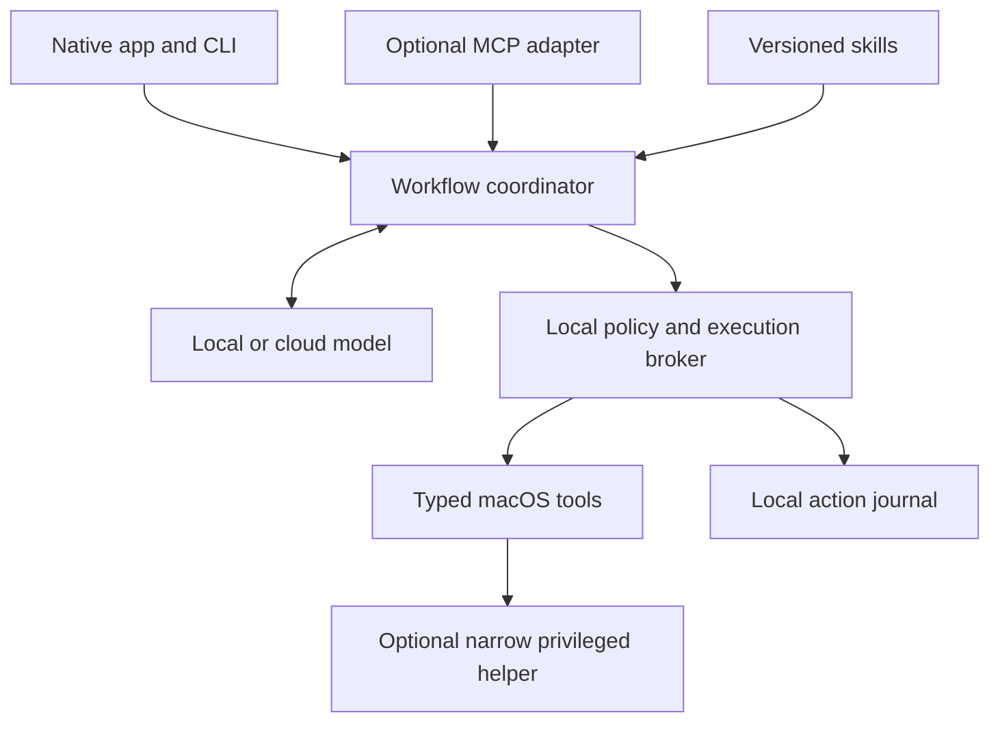

# macOS AI assistant: long-term roadmap

Version 0.1 · 3 October 2026

> **Status, 2026-10-03:** the repository is reviewed. The review is pinned to `979789e` and recorded
> in `docs/audit-2026-10-03.md`. Phase 0 is done except the Mac profile, which `scripts/mac-profile.sh`
> collects on the user's Mac. Phase 1 has started with the backlog items in `tasks/todo.md` (workspace root).
> The plan below is the user's roadmap as adopted. Where the audit changed an assumption, the
> change is in `docs/adr/` and the roadmap text is left as written.

## Direction and evidence

Build a native macOS assistant that understands the state of your Mac, diagnoses problems, manages
supported settings and software, and adds useful workflows through versioned skills and tools. It
starts on your own Mac, runs locally, and offers a choice of local or cloud models.

The first product promise: "Tell me what is wrong, show the evidence, propose a specific change,
and verify whether it helped."

## What "native" and "add/remove features" mean

Native means a SwiftUI/AppKit interface, macOS permission handling, system integrations, local
execution, and a menu bar entry point. It does not require the language model itself to be Apple's
model or to run locally in every workflow.

| User goal | Product capability | Boundary |
|---|---|---|
| Troubleshoot slow performance | Collect bounded CPU, memory, disk, and startup evidence; explain likely causes | A plausible explanation is not a confirmed diagnosis |
| Troubleshoot connectivity | Inspect network state and run bounded DNS/connectivity checks | Defer disruptive network changes until previewed |
| Change behavior | Enable or disable supported preferences and the assistant's own services | Use documented interfaces and keep an OS compatibility map |
| Add features | Install a skill, configure an app integration, or create a Shortcut/workflow | Record dependencies, permissions, and how to remove it |
| Remove features | Disable a supported setting, uninstall a user-installed app, or remove an assistant extension | Keep disable, uninstall, and data deletion separate |
| Change protected OS components | Explain the limitation and offer supported alternatives | Outside the initial scope; no dependency on disabling SIP |

System Integrity Protection restricts modification of protected macOS files and folders [S7].
Unsupported operations are explicit limitations, not invitations to work around the OS.

## Architecture

One local execution path is shared by the native app, a CLI, and an optional MCP adapter. Changing
the model or client never changes what an operation is allowed to do.

| Component | Responsibility | Initial choice |
|---|---|---|
| Native app | Menu bar, task window, permissions, previews, results, history | SwiftUI, AppKit where needed |
| Coordinator | Bounded planning, evidence collection, cancellation, verification | Explicit state machine; model proposes structured steps |
| Model adapter | Inference, structured proposals, optional escalation | Provider-neutral; one local and one cloud adapter first |
| Policy broker | Validate arguments, scope, permissions, approved plan, tool version | Deterministic local checks on every invocation |
| Tool registry | Small actions with typed inputs, outputs, errors, compatibility | Built-in, trusted tools first |
| Skill registry | Problem-solving instructions and workflows using approved tools | Versioned manifests plus readable instructions |
| Journal | Evidence references, preview, consent, attempts, verification, recovery | Local SQLite; defined retention and redaction |
| Privileged helper | The few operations that need elevation | Later; authenticated XPC, fixed operations |
| MCP adapter | Let compatible clients call the same tools | Optional; never an alternative permission path |

Apple's Foundation Models framework supports guided generation and tool calling [S1]. Its system
model depends on runtime availability, including device and region [S2]. It is a local option, not
a mandatory dependency.

Hybrid AI: collect and filter diagnostic evidence locally. Each task has a visible local/cloud mode,
an export preview, and a cost limit. A local model failure never silently sends data to a cloud
model. Cloud access does not imply permission to upload files, raw logs, screenshots, or secrets.

## The execution contract

A skill describes how to solve a problem. A tool performs a bounded operation. A plugin packages
skills, tools, dependencies, and compatibility metadata. Markdown instructions and model output do
not grant system permissions.

Every tool declares an identifier and version, input/output schemas, supported systems, required
capabilities, read/write behavior, resource scope, timeout, cancellation behavior, verification,
and recovery limits. These are checked against trusted registry policy; plugin-provided labels are
not trusted automatically. MCP tools use schemas and require input validation and access controls [S8].

Workflow: inspect → diagnose → preview → authorize when needed → execute → verify → report or
recover. Transitions persist, so a crash leaves a recoverable record. Permissions and target state
are rechecked immediately before execution; a preview is invalid if the target or tool version
changed.

| Operation | Behavior |
|---|---|
| Bounded diagnostics | Runs within the user's task and granted scope; shows evidence and uncertainty |
| Reversible setting change | Shows old/new values; task-scoped consent; explicit preauthorization for specific tools later |
| App install, uninstall, or interruption | Previews exact target, dependencies, data impact, expected downtime |
| Privileged change or deletion | Specific approval tied to target and arguments; never inferred from a broad request |
| Background automation | Explicit rule, scope, schedule/trigger, and easy pause |

The default process is unprivileged. There is no general "run any shell command" tool. Commands use
fixed executables, validated argument arrays, bounded environments and output, and deadlines.
Third-party executable plugins need isolation and resource limits; a manifest is not a sandbox.

The privileged helper authenticates its caller, validates each request independently, and never
exposes an arbitrary command executor. SMAppService registers login items, agents, and daemons on
macOS 13+, subject to approval [S3]; it is not per-operation authorization.

Permissions are requested when a workflow needs them, and denial is handled. Full Disk Access
cannot be granted by code [S6]. GUI automation is a later fallback with explicit Accessibility
permission.

Recovery is operation-specific. Restoring a preference can be reliable; reinstalling an app might
not restore deleted data. No universal rollback promise. Store prior state only where it is safe
and valid, verify recovery, and report partial completion honestly.

## First milestone: Mac Health

Three read-only skills: slow Mac, disk pressure, connectivity. Slow Mac is the first end-to-end
demonstration.

Example: "My Mac became slow after login." The assistant collects a bounded snapshot, identifies
measured pressure, separates transient activity from a persistent problem, and reports a few
evidence-backed hypotheses. It offers a specific next step or says that more evidence is needed. It
does not label every high-CPU process as faulty.

Then: a change adapter for one supported, reversible preference, tested for preview, refusal, stale
state, application, verification, and restoration before any app management.

The first release needs a command/menu bar entry point, model selection, diagnostics, evidence
display, cancellation, and local history. It does not need voice, an autonomous desktop agent, a
marketplace, or a root daemon.

## Phases and release gates

Estimates assume one experienced developer working substantially on the project. They are planning
estimates, not commitments.

| Phase | Effort | Deliverable | Gate before expansion |
|---|---|---|---|
| 0. Audit and product contract | 1–2 weeks | Capability map, baseline, supported Mac profile, architecture decisions | Known inventory and repeatable baseline checks |
| 1. Diagnostics foundation | 3–5 weeks | Typed read-only tools, journal, local/cloud adapter, slow-Mac workflow | Evidence-grounded output; denied permissions, offline, cancellation tested |
| 2. Controlled changes | 4–6 weeks | Preview, scoped consent, stale-state checks, verification, recovery for one preference | Tested change and recovery; no mutation after refusal |
| 3. Native daily use | 4–6 weeks | Menu bar, task window, permission guidance, packaging, history | Useful daily; install/update/uninstall tested |
| 4. Skill platform | 6–8 weeks | Versioned skill loader, compatibility metadata, disable/remove, MCP adapter | A new skill reuses the same execution contract |
| 5. Software and feature management | 6–10 weeks | App integrations, explicit install/uninstall, setting controls | Each operation has dependencies, data-impact disclosure, verification, recovery limits |
| 6. Reliable automation | Months 6–12+ | Opt-in triggers, persistent jobs, bounded retries, pause controls | Repeated use without unapproved changes or hidden export |

Prefer release gates over dates. Re-estimate after Phase 0.

Distribution beyond the development Mac: Developer ID signed, hardened runtime, notarized [S5].
The Mac App Store requires App Sandbox [S4]. Prove system-management capabilities with direct
distribution first; evaluate an App Store edition against real permission needs later.

## First implementation backlog

| # | Work item | Acceptance criteria |
|---|---|---|
| 1 | Audit a pinned commit | AGENTS.md, README, manifests, skills/tools, launch paths, CI, tests, license, secrets; reuse/refactor/retire with file references |
| 2 | Supported Mac profile | Chip, RAM, OS, developer tools, intended local model, minimum support target |
| 3 | Tool and skill contracts | Schemas plus one complete example; malformed arguments rejected before execution |
| 4 | Policy broker | Known tools only; target scope and permission checked on every request; no arbitrary executable path |
| 5 | Bounded health snapshot tools | Structured CPU/memory/disk evidence with timestamps, permission failures, collection limits |
| 6 | Slow-Mac workflow | Claims reference collected evidence; uncertainty and unsupported diagnosis shown |
| 7 | One local and one cloud adapter | Same tool policy for both; offline behavior and cloud-export choice explicit |
| 8 | Journal and cancellation | Cancel stops new steps; interrupted operations recoverable; sensitive output redacted |
| 9 | Smallest native interface | Start task, inspect evidence, choose model mode, cancel, read history |
| 10 | One reversible mutation | Preview binds target/arguments/version; refusal and stale state prevent writes; verify and restore tested |

## Validation and maintenance

Mocked diagnostic fixtures for repeatable behavior; a disposable macOS user or test machine for
real changes. macOS integration tests separate from cross-platform schema and planning tests.
Exercise normal, denied-permission, unsupported-OS, offline, timeout, cancellation, stale-state,
malicious-log, partial-failure, and recovery cases. Logs and app content are untrusted evidence,
not instructions.

Measure completed and verified tasks, unsupported claims, unauthorized mutations, recovery success,
diagnostic latency, cloud cost, and permission friction. Unauthorized mutations stay at zero in
release scenarios. "The command exited successfully" is not "the problem is solved".

After each milestone, update the capability map, compatibility matrix, scenario suite, and roadmap.
Keep short ADRs for execution permissions, model routing, plugin isolation, and distribution.

Later: voice, context-aware app assistance, richer Shortcuts, opt-in background monitoring, public
distribution, team policy — only after the first workflows are useful and reliable.

## Open decisions

- Mac profile (chip, RAM, OS) decides the local-model choice and minimum platform beyond macOS 15.
- Available development time and whether public distribution is a goal set the schedule.
- Slow Mac first, unless disk or network diagnosis matters more on the actual machine.

## Sources

- [S1] Apple, Foundation Models: https://developer.apple.com/documentation/foundationmodels ·
  https://developer.apple.com/documentation/foundationmodels/adding-intelligent-app-features-with-generative-models
- [S2] Apple, SystemLanguageModel availability: https://developer.apple.com/documentation/foundationmodels/systemlanguagemodel ·
  https://developer.apple.com/documentation/foundationmodels/systemlanguagemodel/isavailable
- [S3] Apple, SMAppService: https://developer.apple.com/documentation/servicemanagement/smappservice
- [S4] Apple, App Sandbox: https://developer.apple.com/documentation/security/app-sandbox
- [S5] Apple, Notarizing macOS software: https://developer.apple.com/documentation/security/notarizing-macos-software-before-distribution
- [S6] Apple, Accessing files from the App Sandbox: https://developer.apple.com/documentation/security/accessing-files-from-the-macos-app-sandbox
- [S7] Apple, About System Integrity Protection: https://support.apple.com/en-ie/102149
- [S8] MCP, Tools specification: https://modelcontextprotocol.io/specification/2025-11-25/server/tools
