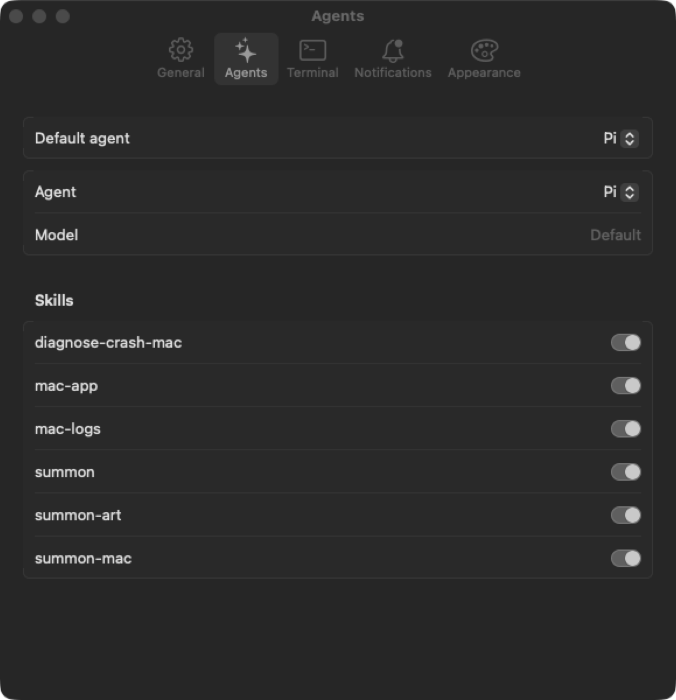
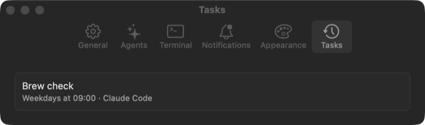
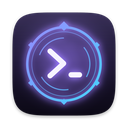
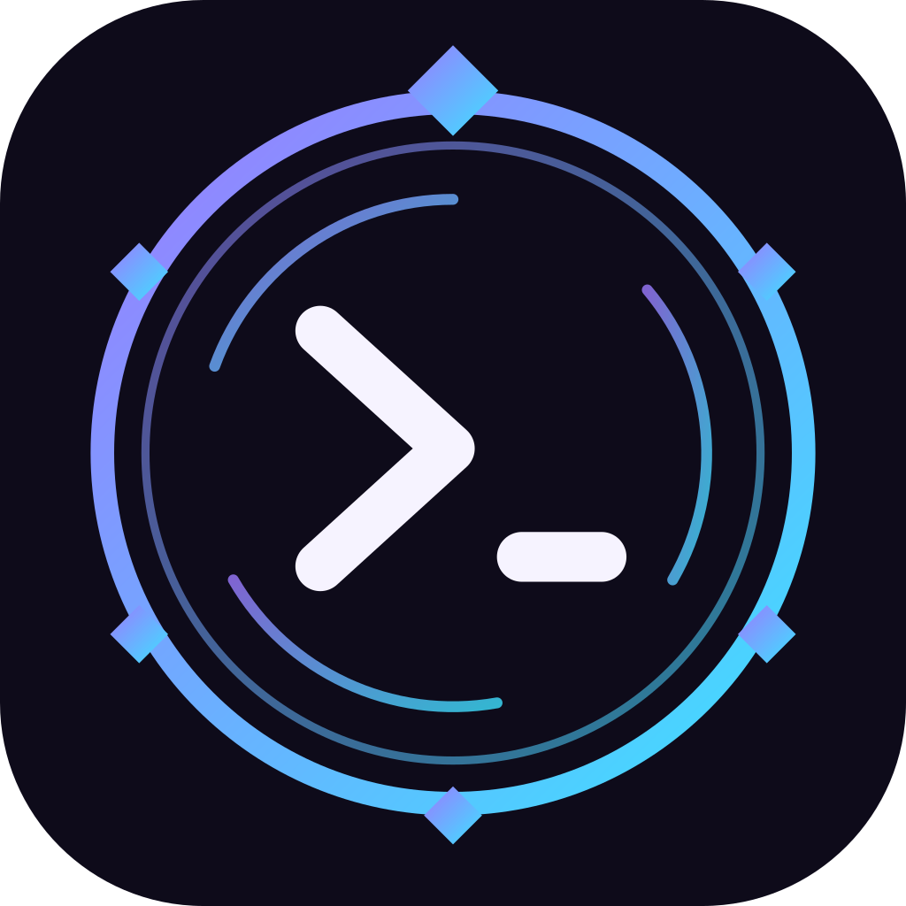
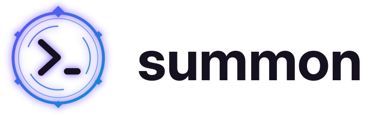
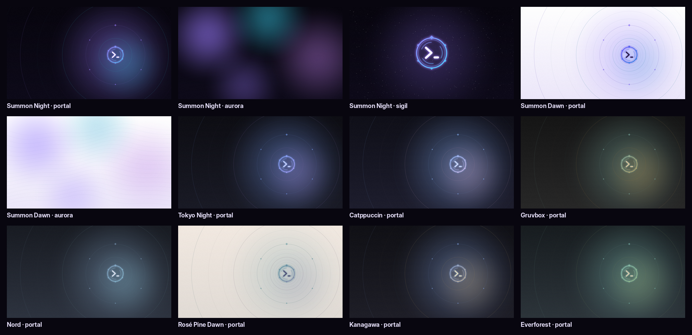

<p align="center"></p>

<p align="center">
  <b>Status:</b> incubating in the <a href="../../README.md">SummonOS</a> workspace. The numbered baseline is
  <b>0.2.5</b> (2026-11-11, release `v0.2.5`, commit `90f7b81` / #124); later branch work may be
  unreleased, and runtime/accessibility acceptance gates remain open.
</p>

# Summon

**Your coding agent, summoned from anywhere on your Mac.** Summon is a native menu bar app and CLI that
opens your chosen agent, supplies Mac context and documented commands, routes crash reports, schedules tasks,
and manages projects and themes. It does not give the agent a sandbox or make every action reversible.
Sessions attempt a checkpoint for supported settings and captured config files; see the
[security and recovery model](../../docs/security-model.md) for the actual limits.

## What it does

- **Summon anything.** Tell any agent "summon, build a web app" or "summon, make my Dock smaller": the `summon`
  skill routes it to the right skill, whether that's Mac settings, themes and art, a new app, crashes, logs, or
  the agent's own skills.
- **Your agents, your way.** Launch Claude Code, Codex, OpenCode, GitHub Copilot, Cursor CLI, Antigravity,
  Pi, Hermes, OpenClaw or Grok in Ghostty, kitty or Terminal. Launch support, MCP connection and scheduled-task
  support are different capabilities; see [Agents and connections](#agents-and-connections).
- **Scoped recovery.** Agent sessions and tasks capture a macctl history marker and, when `~/.config` is a Git
  repository, attempt a config commit. `summon checkpoint undo` restores covered state, not arbitrary files,
  package installs or external actions. Capture warnings matter; scheduled tasks stop on capture failure.
- **The Mac calls the agent.** New actionable crash/hang reports become a macOS notification or Summon alert,
  according to Settings › Notifications. Diagnose hands the report to your agent; Activity keeps the history.
- **Work while you're away.** Describe a recurring task in plain words ("weekdays at 9, check brew updates") and
  the agent writes the run prompt and schedules it. It runs unattended through launchd and reports back in Activity.
- **Looks made on purpose.** New themes, wallpapers and icons come from a mood, three concepts and a palette
  with a contrast check, not a default gradient.

## Native app surfaces

- **Panel:** click the menu bar icon or press **⌃⌥Space**. Search is always visible. Home contains Ask Agent,
  Make Something, My Apps, a setup-attention line when needed, and an eligible Undo offer. Activity…, Settings…
  and Quit Summon stay in the footer. There is no separate launcher window or Now/Recent feed in the panel.
- **Search:** type to find runnable entries across the visible menu tree, including actions not shown at home.
  Submenus have breadcrumb back navigation. The panel takes keys without activating Summon.
- **Settings:** a separate sidebar window for General, Agents, My Apps, Terminal, Notifications, Appearance,
  Setup and Tasks. Preferences do not live in the panel. Right-clicking the icon also offers Settings and Quit.
- **Activity and Updates:** separate foreground windows for history and update progress. The panel's Update
  entry and update-count badge open Updates rather than running an update inline.
- **Welcome and About:** a four-step, optional welcome flow explains setup. Settings › General › About Summon
  opens AppKit's native About panel with version, build, source revision/state, channel, configuration and UTC
  build time; unknown development metadata is labeled honestly. The current branch explicitly raises the native
  About window on cold launch as well as reopening it.

The menu bar normally shows only the icon. The optional agent clock is **off by default** and is enabled in
Settings › General › Menu Bar. See the [panel contract](docs/menubar-panel.md) and
[UX implementation audit](docs/ux-audit.md) for details and outstanding native checks.

| Settings › Agents | Settings › Tasks |
|:---:|:---:|
|  |  |

## Quick start

```bash
./install.sh   # from the repo root (or the curl one-liner in the root README): Summon, macctl, skills linked
summon default agent claude                                       # or codex, opencode, agy, pi, …
summon doctor                                                     # what is set up, what is missing
summon agent prompt "summon, give my Mac a calm dark theme"       # or ⌃⌥⌘A from anywhere
summon task new "weekdays at 9, check brew updates and summarize"     # the agent sets it up
```

Building from source needs Xcode 26 (the macOS 26 SDK), even to run on macOS 15: the code calls macOS 26 APIs
behind `#available`.

Start with the [documentation home](../../docs/index.md), then the
[feature reference](../../docs/features.md#summon) and [changelog](CHANGELOG.md).
The [2026-10-17 plan](../../docs/plans/2026-10-17-summon.md) records the original design, not today's feature contract.
Any move into separate repositories requires an explicit project decision.

## Agents and connections

No agent is preselected. Install and authenticate the agent with its own tools, then choose it in Settings ›
Agents or with `summon default agent <id>`. New installs use **Agent controls** (`normal`); selecting
`summon default execution unattended` bypasses supported harness approvals/sandboxing. Existing configured
installs retain their previous choice. Agent controls means the harness's own behavior, not a Summon sandbox;
Pi, for example, has no approval prompts to restore.

| Capability | Current registry |
|---|---|
| Interactive/prompt launch | `claude`, `codex`, `opencode`, `copilot`, `cursor-agent`, `agy`, `pi`, `hermes`, `openclaw`, `grok` |
| `summon connect` MCP integration | `claude`, `codex`, `cursor` (Cursor CLI alias accepted), `opencode`, `hermes`, `openclaw`, `agy`, `pi` |
| Scheduled headless runs | `claude`, `codex`, `opencode`, `agy`, `pi` |

`agy` is Antigravity; the registry accepts `gemini` as its alias, not a separate Gemini CLI implementation.
Connection support does not imply launch support for every desktop application or a verified login/model probe
for every harness. `summon connect --dry-run` previews connection changes. OpenCode has no configured remove
command, so disconnect can require manual removal of its MCP server. Skills are linked where supported;
otherwise Summon includes skill paths in the prompt.

## Updates and build identity

Automatic checks are on by default: due at launch and again 24 hours after the last check, with automatic
checks skipped in Low Power Mode. Settings › General selects **Stable** (numbered `vX.Y.Z` releases; default)
or **Edge** (the published rolling prerelease). Numbered releases, including `v0.2.4`, are previews/prereleases
too; Stable names a channel, not production maturity. The green-main workflow can publish Edge artifacts,
but the published artifact can lag this branch. Checking is not a silent Summon install.
The Updates window offers Install and Relaunch for Summon, per-row progress for Agents/Homebrew/bun/npm,
section Update All, failure details and Fix with AI. Password failures offer Open in Terminal; macOS updates
open Software Update. Optional automatic agent updates have their own preference.

```bash
summon update --check
summon update --channel edge --check
```

A branch commit, a local development bundle, and a published channel artifact are different things. The current
November work keeps the base version at `0.2.4`; About's full build identity distinguishes candidates. See the
[runtime audit evidence](../../docs/plans/2026-11-08-runtime-audit.md#implementation-evidence-and-unverified-acceptance-2026-11-08)
for recorded results. Controlled comparative profiling, displayed-frame timing, retained-memory analysis,
native banner delivery, VoiceOver and Reduce Transparency remain acceptance gates, not inferred passes.

## Projects and My Apps

`summon project new <name> --kind <starter>` creates a project in `~/Summon/Apps/<name>`. Starters are
`menubar`, `menubar-panel`, `launcher`, `hud`, `notch`, `app`, `widget`, `cli` and `screensaver`.
The widget starter includes the small Xcode project required for its embedded WidgetKit extension; the others
use SwiftPM. Import/register existing projects with `summon project import <path>` or
`summon project register <name>`. The registry is local/private, not the workspace's app registry.

New projects do not create a GitHub repository by default. `summon project repo <name>` requests approval for
a **private** repository. A saved `always` preference remains available as standing approval.

Panel and Settings › My Apps share six categories, even when empty: **Panel Apps**, **Themes**,
**Art & Wallpapers**, **Window Apps**, **Command-Line Tools** and **Screensavers**. Built-in and custom themes
appear together. Launcher/HUD/notch starters are registered as panel apps; widget projects are window apps.

Repair totals count each defective inventory item once. Missing required files, referenced images or a real
build artifact are repairs; optional icons/screenshots/wallpapers and palette/readability recommendations are
not. Contrast findings stay visible separately from hue advice, and preset palettes are not automatically
rewritten. My Apps' Fix with AI and `summon fix --apps` target the counted defects; `summon fix` remains the
separate general-Mac diagnostic action.

## Checkpoints and themes

Checkpoint undo restores Git-captured config files and covered macctl changes after the marker. It may affect
later supported changes, not just one agent's edits. Files created later generally remain unless recorded as
Summon-owned creations (such as theme outputs). Read capture warnings and review an undo before approving it;
this is not a full-machine backup.

The active theme drives Summon's control accent live. Style and My Apps use the same active selection and
previous-theme tracking, and a preview is not reported as applied. macctl posts color-refresh notifications
after accent apply/undo/recovery; Finder's **Automatic** folder color follows the system accent, while explicit
folder colors are preserved. Other apps may still need reopening. Catppuccin's bundled accent/active border
uses mauve (`#cba6f7`).

## Runtime hardening (unreleased)

The November branch changes keep scheduled-run identity and terminal outcomes consistent across CLI, Activity
and notifications; bounded completion summaries do not replace full task logs. Persistence/retention/notification
failures stay separate from execution success. Pending-marker recovery avoids a second contradictory outcome
after a committed result, and task leases release before notification delivery. Cleanup protects active/pending
logs, ranks completed logs by modification time and surfaces partial Trash failures.

Panel and Activity now share off-main, generation-checked refresh work, and event watches handle creation and
replacement without relying on writer timestamps. App-owned work stops explicitly at shutdown. A recorded
native 13-report equal-timestamp crash burst exercised real watcher batching, alert dismissal and subsequent
typed search; it does not establish native banner delivery or VoiceOver acceptance. See the
[current status](../../docs/status.md) and [UX audit](docs/ux-audit.md#evidence-boundaries-and-remaining-acceptance)
before treating implementation as release-readiness evidence.

## Brand

| App icon | Mark | Wordmark |
|:---:|:---:|:---:|
|  |  | <picture><source media="(prefers-color-scheme: dark)" srcset="design/brand/wordmark-dark.png"></picture> |

Also in [`design/brand/`](design/brand): app icons at 128 to 1024 px, the menu bar template icon
(`menubar-icon.png`, `@2x`), `mark.svg` (transparent), `mark-template.svg` (black, for templates), and
the 1600x900 banner above.

## Themes

Each theme is a `theme.json` (colors, 16 terminal colors, font) plus 5K wallpapers in [`themes/`](themes).
Summon's own are **Summon Night** (the default) and **Summon Dawn** (its light variant). Seven well-known
community palettes are included too (Tokyo Night, Catppuccin, Gruvbox, Nord, Rosé Pine Dawn, Kanagawa,
Everforest), credited in [THIRD_PARTY_NOTICES.md](THIRD_PARTY_NOTICES.md). New themes are made with the
`summon-art` skill.



## What is here

| Path | What |
|---|---|
| `plugin/` | Claude Code plugin (needs `summon` and `macctl`): skills `summon`, `summon-mac`, `summon-art`, `mac-app`, `mac-app-test`, `summon-migrate`, `diagnose-crash-mac`, `mac-logs`; commands `/summon:setup`, `/summon:fix`, `/summon:theme`, `/summon:icon`, `/summon:new-menubar`, `/summon:new-app`, `/summon:new-cli`, `/summon:new-screensaver`, `/summon:activity`; session hooks record agent sessions in Activity |
| `themes/` | 9 themes (`theme.json` + 5K wallpapers): Summon Night and Summon Dawn, plus seven community palettes |
| `config/` | Desktop layer: `Brewfile` (AeroSpace, Ghostty, JankyBorders, Nerd Font), `aerospace.toml` (⌥ keymap), Ghostty config with a drop-down quick terminal, borders, shell aliases (`a`, `ap`) |
| `design/` | Logo, app icon, menu bar icon, wordmarks, `generate.py`, which renders all of them plus the wallpapers, and `brandkit.py`, the palettes and SVG mark it shares with the workspace README art |
| `templates/` | Nine project starters for `summon project new`; each has its own README and checks |
| `scripts/` | `check.sh`, `bundle.sh`, `install.sh`, `test.sh`; guarded runtime audit/trace tooling and `visual-qa/` for disposable GUI runners |
| `Sources/`, `Tests/` | The `summon` CLI, the Summon Menu app, and their tests |

## Install the plugin (Claude Code)

Install Summon and `macctl` first (`scripts/bundle.sh && scripts/install.sh`, then `summon doctor`). There
is no marketplace entry yet, so load the plugin from this folder:
`claude --plugin-dir incubator/summon/plugin`. `summon skills link` (run by `install.sh` and on every app
launch) also links the skills into every installed agent.

## Default keys

| Keys | Does |
|---|---|
| ⌃⌥Space | Summon panel (recordable in Settings) |
| ⌃⌥⌘A | Ask the default agent about the current screen context (recordable) |
| ⌥Return (in panel) | Quick-launch/Ask Agent action (recordable) |
| ⌃⌥⌘\` | Drop-down terminal (type `a` for the agent) |
| ⌥1…9, ⌥⇧1…9 | Workspaces |
| ⌥H J K L, ⌥⇧H J K L | Focus, move windows |
| ⌥Return | Ghostty |

## Regenerate the art

```bash
python3 incubator/summon/design/generate.py          # full 5120×2880 wallpapers
python3 incubator/summon/design/generate.py --quick  # 1/4 size, for iterating
```

Needs Pillow and numpy. The Inter and DejaVu fonts it uses are the defaults on most Linux images; on a Mac,
point `FONT_BOLD` / `FONT_MONO` at any bold sans. Palettes and the SVG mark live in `design/brandkit.py`;
after changing them, also run `python3 tools/readme-art.py` from the repo root so the workspace README art
follows.

## Where it started

Summon began as **mac-assistant** (2026-10-03): a native assistant that diagnoses the Mac from read-only evidence,
proposes a fix and checks it, with every action behind one policy broker and a preview before anything goes to a
cloud model. Its Phase 0/1 skeleton, roadmap and design notes are archived at the git tag `archive/mac-assistant`
(`git show archive/mac-assistant`).

## License

MIT. Credits for the community palettes and adapted skill structure: [THIRD_PARTY_NOTICES.md](THIRD_PARTY_NOTICES.md).
