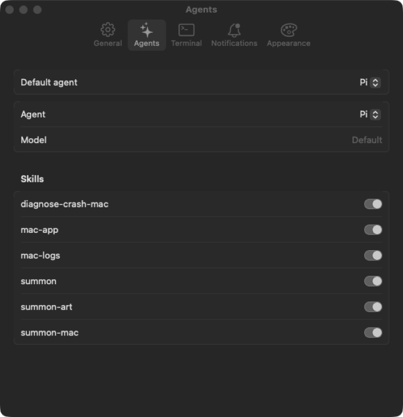
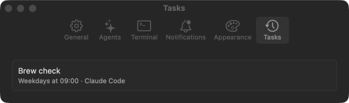
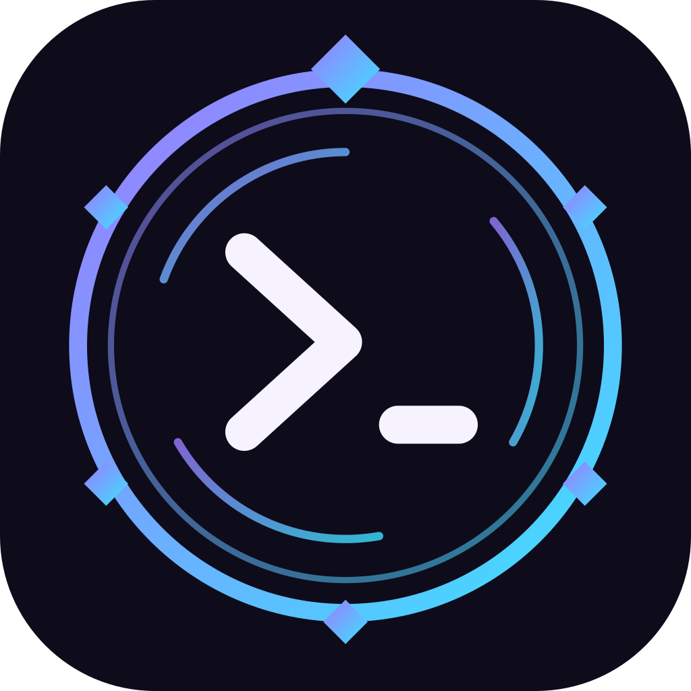
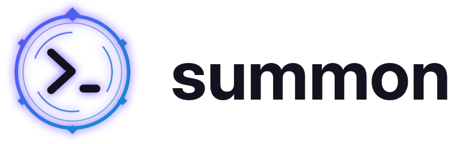
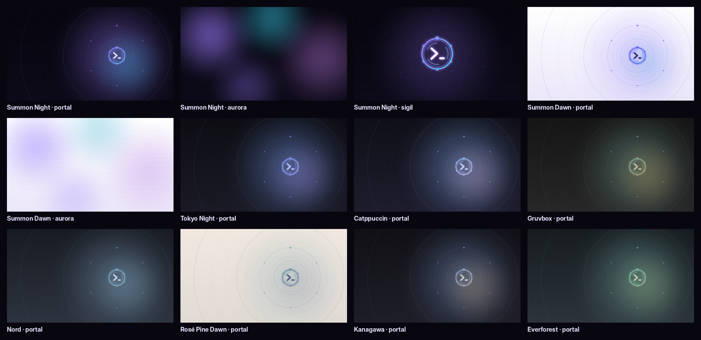

<p align="center"></p>

<p align="center">
  <b>Status:</b> incubating in <code>macos-plugins</code>. The CLI and menu app build, pass their tests and
  were installed and used on a Mac on 2026-10-18.
</p>

# Summon

**One coding agent you can summon from anywhere on your Mac.** It sees the whole Mac through documented
commands, is handed problems automatically (crashes, hangs), and can set up, theme, fix and build things for
you. Every session is checkpointed, so anything it does can be undone.

## What it does

- **Summon anything.** Tell any agent "summon, build a web app" or "summon, make my Dock smaller": the `summon`
  skill routes it to the right skill, whether that's Mac settings, themes and art, a new app, crashes, logs, or
  the agent's own skills.
- **Your agents, your way.** Claude Code, Codex, OpenCode, Antigravity, Pi and more, each with its own model and
  its own set of skills, opened in Ghostty, kitty or Terminal with permission prompts bypassed.
- **Nothing is permanent.** Every agent session and task starts with a checkpoint (macOS settings plus your
  `~/.config`), and `summon checkpoint undo` puts it back.
- **The Mac calls the agent.** A crash or hang turns into a notification with Diagnose, which hands the
  report to your agent.
- **Work while you're away.** Describe a recurring task in plain words ("weekdays at 9, check brew updates") and
  the agent writes the run prompt and schedules it. It runs unattended through launchd and reports back in Activity.
- **Looks made on purpose.** New themes, wallpapers and icons come from a mood, three concepts and a palette
  with a contrast check, not a default gradient.

| Settings › Agents | Settings › Tasks |
|:---:|:---:|
|  |  |

## Quick start

```bash
cd incubator/summon && scripts/bundle.sh && scripts/install.sh   # app in ~/Applications, `summon` on PATH, skills linked
summon default agent claude                                       # or codex, opencode, agy, pi, …
summon doctor                                                     # what is set up, what is missing
summon agent prompt "summon, give my Mac a calm dark theme"       # or ⌃⌥⌘A from anywhere
summon task new "weekdays at 9, check brew updates and summarize"     # the agent sets it up
```

Every feature, command by command: [`docs/features.md`](../../docs/features.md#summon). What changed:
[`CHANGELOG.md`](CHANGELOG.md).
Moves to its own repos, `mac-summon-dev` / `mac-summon`, with the owner's OK.
Plan: [`docs/plans/2026-10-17-summon.md`](../../docs/plans/2026-10-17-summon.md).

## Brand

| App icon | Mark | Wordmark |
|:---:|:---:|:---:|
|  |  | <picture><source media="(prefers-color-scheme: dark)" srcset="design/brand/wordmark-dark.png"></picture> |

Also in [`design/brand/`](design/brand): app icons at 128 to 1024 px, the menu bar template icon
(`menubar-icon.png`, `@2x`), `mark.svg` (transparent), `mark-template.svg` (black, for templates), and
the 1600x900 banner above.

## Themes

Each theme is a `theme.json` (colors, 16 terminal colors, font) plus 5K wallpapers in [`themes/`](themes).
Summon's own are **Summon Night** (the default) and **Summon Dawn** (its light variant). Seven well-known
community palettes are included too (Tokyo Night, Catppuccin, Gruvbox, Nord, Rosé Pine Dawn, Kanagawa,
Everforest), credited in [THIRD_PARTY_NOTICES.md](THIRD_PARTY_NOTICES.md). New themes are made with the
`summon-art` skill.



## What is here

| Path | What |
|---|---|
| `plugin/` | Claude Code plugin (needs the `summon` and `macctl` binaries): skills `summon` (router), `summon-mac`, `summon-art`, `mac-app`, `diagnose-crash-mac`, `mac-logs`; commands `/summon:setup`, `/summon:fix`, `/summon:theme`, `/summon:icon`, `/summon:new-menubar`, `/summon:new-app`, `/summon:new-cli`, `/summon:new-screensaver`, `/summon:activity`; `SessionStart`/`SessionEnd` hooks that record agent sessions for the Activity window |
| `themes/` | 9 themes (`theme.json` + 5K wallpapers): Summon Night and Summon Dawn, plus seven community palettes |
| `config/` | Desktop layer: `Brewfile` (AeroSpace, Ghostty, JankyBorders, Nerd Font), `aerospace.toml` (⌥ keymap), Ghostty config with a drop-down quick terminal, borders, shell aliases (`a`, `ap`) |
| `design/` | Logo, app icon, menu bar icon, wordmarks, `generate.py`, which renders all of them plus the wallpapers, and `brandkit.py`, the palettes and SVG mark it shares with the workspace README art |
| `templates/` | Project templates for `summon project new`: menu bar app, window app, CLI tool, screensaver |
| `scripts/` | `check.sh` (the gate), `bundle.sh`, `install.sh`, `test.sh` |
| `Sources/`, `Tests/` | The `summon` CLI, the Summon Menu app, and their tests |

## Install the plugin (Claude Code)

Install Summon and `macctl` first (`scripts/bundle.sh && scripts/install.sh`, then `summon doctor`). There
is no marketplace entry yet, so load the plugin from this folder:
`claude --plugin-dir incubator/summon/plugin`. `summon skills link` (run by `install.sh` and on every app
launch) also links the skills into every installed agent.

## Default keys

| Keys | Does |
|---|---|
| ⌃⌥Space | Summon Menu |
| ⌃⌥⌘A | Summon the agent |
| ⌃⌥⌘\` | Drop-down terminal (type `a` for the agent) |
| ⌥1…9, ⌥⇧1…9 | Workspaces |
| ⌥H J K L, ⌥⇧H J K L | Focus, move windows |
| ⌥Return | Ghostty |

## Regenerate the art

```bash
python3 incubator/summon/design/generate.py          # full 5120×2880 wallpapers
python3 incubator/summon/design/generate.py --quick  # 1/4 size, for iterating
```

Needs Pillow and numpy. The Inter and DejaVu fonts it uses are the defaults on most Linux images; on a Mac,
point `FONT_BOLD` / `FONT_MONO` at any bold sans. Palettes and the SVG mark live in `design/brandkit.py`;
after changing them, also run `python3 tools/readme-art.py` from the repo root so the workspace README art
follows.

## License

MIT. Credits for the community palettes and adapted skill structure: [THIRD_PARTY_NOTICES.md](THIRD_PARTY_NOTICES.md).
