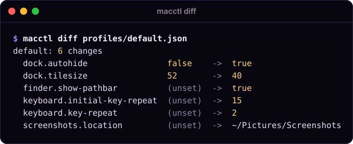
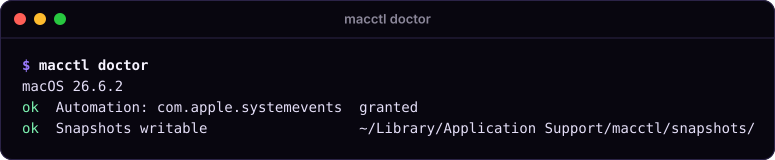
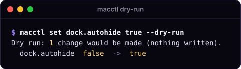
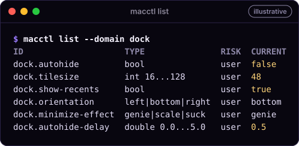
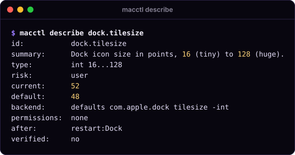
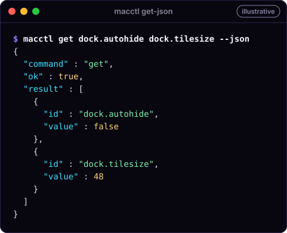

<p align="center">
  <picture>
    <source media="(prefers-color-scheme: dark)" srcset="../docs/assets/macctl-logo-dark.svg">
    
  </picture>
</p>

<p align="center">
  
</p>

# macctl

A command-line tool that reads, sets, diffs, applies and undoes macOS settings. It is built for AI
agents, and people can use it too. Every setting comes from a typed catalog, so an agent never has to
guess a `defaults` key. Every change saves a snapshot first, and `macctl undo` restores it.

<p align="center">
  
</p>

<sub>Terminal output on this page was recorded on macOS 26.6.2 by `tools/record-demos.sh` (read-only
commands; the home folder is shown as `~`).</sub>

## Why

- **A typed catalog.** Each setting has an id, a type (`bool`, `int 16...128`, `left|bottom|right`), a
  risk tier, the permissions it needs and its side effects. `describe` shows all of it before you `set`.
- **Snapshots and undo.** Every write saves the old values first. `macctl undo` puts them back, one
  change at a time, including keys that were unset before.
- **JSON for agents.** `--json`, or any pipe, gives exactly one object per run with stable error codes
  and exit codes, so an agent can act on the result without parsing text.

Requires macOS 15 or later.

## Install

```sh
swift build -c release --scratch-path ~/Library/Caches/macplugins/macctl/build
# The workspace's ../install.sh installs both macctl and Summon into your user account.
```

## Quick tour

**1. Check permissions.** `doctor` shows the macOS version, which permissions are granted, and a System
Settings link for each missing one.



**2. Look before you write.** `diff` (above) shows what a profile would change. `--dry-run` does the
same for `set` and `apply`. Neither writes anything.



**3. Change, then undo.** A real `set` or `apply` prints the snapshot id it saved; `undo` restores it.

```sh
macctl set dock.autohide true    # Applied 1 change. Snapshot <id>. Revert with: macctl undo <id>
macctl undo                      # restores the newest change that was not undone yet
```

## Commands

| Command | What it does |
|---|---|
| `macctl doctor` | macOS version, which permissions are granted, and a System Settings link for each missing one |
| `macctl list [--domain <d>]` | every setting with its type, risk and current value |
| `macctl describe <id>` | full schema of one setting (read this before `set`) |
| `macctl get <id>...` | current value of one or more settings |
| `macctl set <id> <value> [--dry-run] [--yes]` | change one setting |
| `macctl diff <profile.json>` | what `apply` would change; writes nothing |
| `macctl apply <profile.json> [--dry-run] [--yes] [--only <domain>]` | make the Mac match a profile |
| `macctl snapshot list` | snapshots, newest first (`macctl snapshot` alone does the same) |
| `macctl snapshot show <id>` | the old values one snapshot holds |
| `macctl undo [<id>] [--force] [--dry-run]` | roll back a change (the newest when no id is given); `--force` also overwrites keys changed by hand (needs an id); `--dry-run` shows what undo would do to each change |
| `macctl recover [--force] [--abandon <id>]` | roll back any operation that was interrupted or failed; safe to run again |
| `macctl discover start [--domain <d>]...` / `discover diff` | find the key behind a System Settings control: save a baseline, change the control, list what changed. Read-only |

Every command takes `--json`. Run `macctl <command> --help` for details. The full catalog is in
[`docs/settings.md`](docs/settings.md).





### Examples

```sh
macctl doctor
macctl list --domain dock
macctl describe dock.tilesize
macctl get dock.autohide dock.tilesize
macctl set dock.autohide true --dry-run
macctl set dock.autohide true
macctl set desktop.wallpaper ~/Pictures/wall.jpg   # every screen; undo restores the old picture
macctl diff profiles/default.json
macctl apply profiles/default.json --only finder
macctl snapshot list
macctl snapshot show 20261016-142501
macctl undo
```

A value that starts with `-` needs `--` before it: `macctl set some.setting -- -1`.

### Profiles

A profile is a JSON file of desired values. `apply` is idempotent: it changes only the settings that
differ, and does nothing when the Mac already matches.

```json
{
  "name": "my-mac",
  "version": 1,
  "settings": {
    "dock.autohide": true,
    "dock.tilesize": 40,
    "finder.show-extensions": true,
    "screenshots.location": "~/Pictures/Screenshots"
  }
}
```

`--only dock` applies just the settings whose id starts with `dock.`.

## Reference

### JSON output

Output is JSON when you pass `--json`, or when stdout is not a terminal (a pipe, or an agent's
shell). Each run prints exactly one object, with sorted keys and ISO 8601 dates.



Success:

```json
{
  "command" : "get",
  "ok" : true,
  "result" : [
    { "id" : "dock.autohide", "value" : true }
  ]
}
```

Failure (the exit code matches the error):

```json
{
  "command" : "set",
  "error" : {
    "code" : "needs_confirmation",
    "message" : "network.hostname is admin risk; pass --yes to apply."
  },
  "ok" : false
}
```

`result` by command:

- `list`: an array of settings. `describe`: one setting. Each setting has `id`, `domain`, `summary`,
  `type` (`{"kind": "int", "min": 16, "max": 128}`, or `{"kind": "enum", "values": [...]}`), `risk`,
  `permissions` (such as `"automation:com.apple.systemevents"`), `sideEffects` (such as
  `"restart:Dock"` or `"logout"`), `backend`, `verified`, `verifiedOn`, `systemDefault`, `current`, and
  `currentError` when the value could not be read.
- `get`: an array of `{"id", "value"}`; `desktop.wallpaper` reads the main screen's picture path. `value` is `null` when the key is unset and has no known default.
- `diff`: `{"profile", "changes": [{"id", "from", "to"}]}`. A missing `from` means the key is unset.
- `set`, `apply`, `undo`: `{"snapshotID", "changes", "dryRun", "notes"}`.
- `undo --dry-run`: `{"snapshotID", "force", "items": [{"id", "action", "current", "restoresTo", "reason"}], "wouldSucceed", "notes"}`;
  `action` is `restore`, `delete`, `already_restored`, `hand_edited` or `cannot_restore`, newest change first.
- `describe`/`list` settings also carry `minimumOS` (null = every supported macOS) and `recovery`:
  `{"restore": "exact"|"value"|"conditional"|"compare_only", "priorStates", "verifiedByReadBack", "handEdits", "notUndone", "notes"}`.
- `discover start`: `{"baseline", "domains", "keys"}`. `discover diff`: `{"baselineCreatedAt", "macOSVersion", "domains",
  "changes": [{"appID", "host", "key", "kind", "before", "after", "suggestion"}]}`.
- `recover`: `{"sessions": [{"id", "reverted", "notApplied", "flagged"}], "notes"}`; `sessions` is empty when nothing was unfinished.
- `snapshot list`: an array of `{"id", "createdAt", "changeCount", "settings", "status"}`. `status` comes from the
  journal: `completed`, `rolled_back`, `undone`, `recovered`, `pending` (unfinished: run `macctl recover`), or
  `failed` (older snapshots only). The header file on disk always says `pending`; read the status from this command.
- `snapshot show`: `{"id", "createdAt", "changes"}`.
- `doctor`: `{"macOSVersion", "checks": [{"name", "ok", "detail", "fixURL"}]}`.

Error codes: `unknown_setting`, `invalid_value`, `command_failed`, `permission_missing`,
`needs_confirmation`, `unsupported`, `snapshot_not_found`, `no_snapshots`, `invalid_profile`,
`internal_error`, `mutation_failed`, `snapshot_exists`, `transaction_busy`, and:

- `managed_setting`: the key is forced by a configuration profile (MDM); nothing was written.
- `recovery_pending`: an earlier operation did not finish (`recoverySnapshot` names it). Every `set`, `apply`
  and `undo` refuses until `macctl recover`.
- `journal_corrupt`: a journal line before the last is unreadable; that session is not recovered automatically
  and nothing was written. Inspect it, then `macctl recover --abandon <id>` (the file is kept as `<id>.jsonl.corrupt`).
- `partial_restore`: undo or recover restored everything except the keys in `flagged`, which changed after macctl
  wrote them (or whose old value cannot be restored). They are left as they are; `macctl undo <id> --force` overwrites them.
- `invalid_test_mode`: a `MACCTL_TEST_MODE` variable is set without `MACCTL_TEST_MODE=1`, or test mode is incomplete
  or names a domain outside `com.summonos.test.` (exit 64).

`mutation_failed` now means the batch was rolled back at once; `appliedSettings` (name kept for compatibility) lists
keys left as they are, not restored: changed by someone else, a third value on read-back, or a restore that did not
take (normally none). `undo --force` cannot overwrite the failed change's third value of a `rolled_back` session
(undo walks applied changes only). A legacy `failed` snapshot from an older macctl is not rolled back by `recover`
and does not block writes (its partial writes were left in place by design); `doctor` lists it and `macctl undo <id>`
reverts it. Every restore is read back; one that did not take is `revert_flagged` (`partial_restore`).

### Exit codes

| Code | Meaning |
|---|---|
| 0 | ok |
| 1 | error (unknown setting, invalid value, bad profile, a system command failed) |
| 2 | needs a permission; run `macctl doctor` for the System Settings link |
| 3 | needs confirmation; rerun with `--yes` |
| 4 | not supported on this macOS version |

Command-line usage errors (a missing argument) exit with 64 and print usage to stderr.

### Safety

- **Journal and recovery** ([ADR](../docs/adr/ADR-macctl-recovery.md)). Each `set`, `apply` and `undo` of an old
  snapshot runs as a session: a write-once header `snapshots/<id>.json` (never rewritten) and an append-only journal
  `journal/<id>.jsonl` (0600, directory 0700). Every key's prior state (absent, explicit with its exact type, or
  inherited) is fsynced before the write, then read back. A failed write rolls the batch back at once. A crash
  leaves the session unfinished: further writes refuse with `recovery_pending` until `macctl recover` rolls it
  back (idempotent). Undo of a session adds revert lines to its own journal (no redo). A key changed by hand after
  macctl wrote it is flagged and left alone (`partial_restore`) unless `--force`. `--force` is for an explicit
  user decision only: Summon never passes it, and an agent must not add it without the user confirming that the
  flagged keys may be overwritten.
- **Safe ids.** Every session id (`undo <id>`, `recover --abandon <id>`) must be letters, digits, `-` or `_`;
  anything else (for example `../x`) is `snapshot_not_found` before a path is built.
- **CFPreferences, not `defaults`.** `.defaults` settings read and write through CFPreferences on the exact
  `(domain, current user, host)` triple, keeping CF types; managed keys are refused (`managed_setting`).
- **Display-aware wallpapers.** New snapshots retain display UUIDs and paths; reconnect missing displays
  before restoration. Older scalar snapshots remain readable. A deleted wallpaper file cannot be recreated.
- Use the upgraded executable for recovery: older binaries ignore the journal. External preference
  changes are outside macctl's process lock. See the [security model](../docs/security-model.md).

- **Snapshots.** Before writing anything, `set`, `apply` and `undo` record the old values under
  `~/Library/Application Support/macctl/` (`snapshots/` and `journal/`). `macctl undo` reverts the newest change;
  `macctl undo <id>` a given one. A key that was unset (or inherited) before is deleted again; a key that held a
  value gets that exact value and type back, even when it equals the default.
- **Test mode.** `MACCTL_TEST_MODE=1` with `MACCTL_SNAPSHOT_DIR`, `MACCTL_TEST_CATALOG` (domains must start with
  `com.summonos.test.`), optional `MACCTL_FAKE_DEFAULTS` and `MACCTL_FAILPOINT=<point>[@n]|list|trace` is the
  crash-test seam; restarts never run in it. Without `MACCTL_TEST_MODE=1` these variables are refused.
  `MACCTL_TEST_NOW=<unix seconds>` fixes the clock (stable session ids). The fake store also reads the knobs
  `.fail-writes.plist`, `.drop-writes.plist` and `.read-back.plist` in its directory (each consumed by the first write).
- **Crash matrix.** `Tests/MacCtlCrashTests` kills the built binary at every failpoint and checks that `recover`
  restores every test domain byte for byte. `swift test` runs a smoke slice; the full matrix:
  `MACCTL_CRASH_BACKEND=fake|cfprefs MACCTL_CRASH_SHARD=1/3 swift test --filter MacCtlCrashTests` (CI job
  `macctl-crash-matrix`). `cfprefs` writes only `com.summonos.test.<uuid>` domains and deletes them afterwards.
- **Dry runs.** `--dry-run` and `diff` show the plan and write nothing.
- **Risk tiers.** Each setting has a risk: `read`, `user` (Dock, Finder, keyboard, appearance: applied
  directly), `admin` and `destructive` (refused with exit code 3 unless you pass `--yes`).
- **Permissions.** macctl checks permissions without triggering a prompt. A missing one stops the
  command with exit code 2 and a link to the right System Settings pane. macOS gives the grant to the
  app that runs macctl (Terminal, iTerm, or your agent's host app).
- **No shell strings.** Values reach `defaults` and `osascript` only as separate arguments, never spliced
  into a shell or AppleScript text.
- **Side effects.** Some settings need Dock or Finder restarted, or a logout. `apply` restarts each
  process once at the end and lists what still needs a logout in `notes`.

## Demos

The terminal cards are rendered from the transcripts in [`docs/demo/`](docs/demo) by
`tools/readme-art.py` (from the repo root). To record real ones on a Mac, with macctl installed:

```sh
brew install vhs          # optional, for docs/demo/demo.gif
tools/record-demos.sh     # runs only read-only commands, scrubs $HOME and tools/private-patterns.txt
```

## License

MIT
