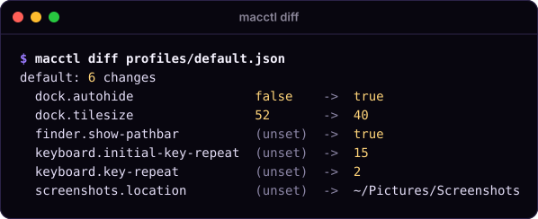
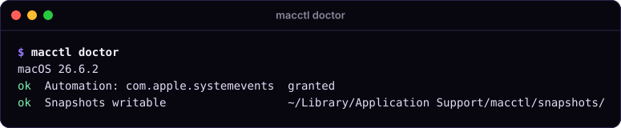
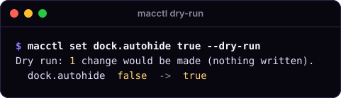
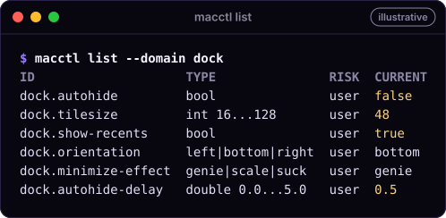
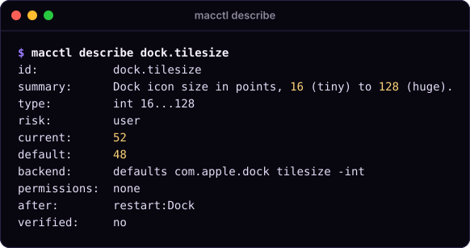
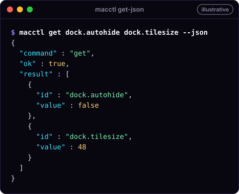

<p align="center">
  <picture>
    <source media="(prefers-color-scheme: dark)" srcset="../docs/assets/macctl-logo-dark.svg">
    
  </picture>
</p>

<p align="center">
  
</p>

# macctl

A command-line tool that reads, sets, diffs, applies and undoes macOS settings. It is built for AI
agents, and people can use it too. Every setting comes from a typed catalog, so an agent never has to
guess a `defaults` key. Before a setting changes, macctl records its prior state; `macctl undo` restores
what that setting's recovery contract allows (see [Safety](#safety)).

<p align="center">
  
</p>

<sub>Historical terminal output on this page was recorded on macOS 26.6.2 by `tools/record-demos.sh`
(read-only commands; the home folder is shown as `~`). It is not a fresh verification of this checkout.</sub>

## Why

- **A typed catalog.** Each setting has an id, a type (`bool`, `int 16...128`, `left|bottom|right`), a
  risk tier, the permissions it needs and its side effects. `describe` shows all of it before you `set`.
- **Snapshots and undo.** Writes record the prior state first. `macctl undo` restores changes,
  including preference keys that were unset before, subject to hand-edit and backend limits.
- **JSON for agents.** `--json`, or a pipe, gives one JSON envelope for command results and execution
  errors. Argument-parser errors, help/version output and test-mode setup diagnostics are separate.

Requires macOS 15 or later and Swift 6 to build. The current source reports `macctl 0.2.6`, matching
the workspace [`VERSION`](../VERSION). This base version alone does not identify a build, channel,
source revision or published release; Summon's packaged build identity is a separate contract.

Browse the [documentation home](../docs/home.md), [feature reference](../docs/features.md),
[settings catalog](docs/settings.md) and [security/recovery model](../docs/security-model.md).

## Install

From `macctl/` in this checkout:

```sh
swift build -c release --scratch-path ~/Library/Caches/macplugins/macctl/build --product macctl
# Install both macctl and Summon into your user account from the checkout:
bash ../install.sh --from-source
```

Building alone does not put `macctl` on `PATH`. The workspace installer installs it into `~/.local/bin`;
see the [installation guide](../docs/install-ai.md) for distribution and trust details.

## Quick tour

**1. Check permissions.** `doctor` shows the macOS version, which permissions are granted, and a System
Settings link for each missing one.



**2. Look before you write.** `diff` (above) shows what a profile would change. `--dry-run` does the
same for `set` and `apply`. Neither writes anything.



**3. Change, then undo.** A `set` or `apply` that changes values prints its saved snapshot id;
a no-op creates no snapshot. `undo` restores the recorded prior state within the limits below.

```sh
macctl set dock.autohide true    # Applied 1 change. Snapshot <id>. Revert with: macctl undo <id>
macctl undo                      # restores the newest change that was not undone yet
```

## Commands

| Command | What it does |
|---|---|
| `macctl doctor` | macOS version, which permissions are granted, and a System Settings link for each missing one |
| `macctl list [--domain <d>]` | every setting with its type, risk and current value |
| `macctl describe <id>` | full schema of one setting (read this before `set`) |
| `macctl get <id>...` | current value of one or more settings |
| `macctl set <id> <value> [--dry-run] [--yes]` | change one setting |
| `macctl diff <profile.json>` | what `apply` would change; writes nothing |
| `macctl apply <profile.json> [--dry-run] [--yes] [--only <domain>]` | make the Mac match a profile |
| `macctl snapshot list` | snapshots, newest first (`macctl snapshot` alone does the same) |
| `macctl snapshot show <id>` | the old values one snapshot holds |
| `macctl undo [<id>] [--force] [--dry-run]` | roll back a change (the newest when no id is given); `--force` also overwrites keys changed by hand (needs an id); `--dry-run` shows what undo would do to each change |
| `macctl recover [--force] [--abandon <id>]` | roll back unfinished journaled operations, including an interrupted rollback; safe to run again; legacy `failed` snapshots need explicit undo |
| `macctl discover start [--domain <d>]...` / `discover diff` | save a baseline, change a System Settings control, then inspect changed keys; does not write preferences, but `start` saves a private baseline file |

Every command takes `--json`. Run `macctl <command> --help` for details. The full catalog is in
[`docs/settings.md`](docs/settings.md).





### Examples

```sh
macctl doctor
macctl list --domain dock
macctl describe dock.tilesize
macctl get dock.autohide dock.tilesize
macctl set dock.autohide true --dry-run
macctl set dock.autohide true
macctl set desktop.wallpaper ~/Pictures/wall.jpg   # every screen; undo restores the old picture
macctl diff profiles/default.json
macctl apply profiles/default.json --only finder
macctl snapshot list
macctl snapshot show 20261016-142501
macctl undo
```

A value that starts with `-` needs `--` before it: `macctl set appearance.accent-color -- -1`.
There is no public `reset` command; `undo` can remove a preference key that was absent before the change.

### Profiles

A profile is a JSON file of desired values. `apply` is idempotent: it changes only the settings that
differ, and does nothing when the Mac already matches.

```json
{
  "name": "my-mac",
  "version": 1,
  "settings": {
    "dock.autohide": true,
    "dock.tilesize": 40,
    "finder.show-extensions": true,
    "screenshots.location": "~/Pictures/Screenshots"
  }
}
```

`--only dock` applies just the settings whose id starts with `dock.`.

## Reference

### JSON output

Command results and execution errors use JSON when you pass `--json`, or when stdout is not a
terminal (a pipe, or an agent's shell). Each such result is one object, with sorted keys and ISO 8601
dates. `--help`, `--version`, parser failures and test-mode setup errors do not use this envelope.



Success:

```json
{
  "command" : "get",
  "ok" : true,
  "result" : [
    { "id" : "dock.autohide", "value" : true }
  ]
}
```

Failure (the exit code matches the error):

```json
{
  "command" : "set",
  "error" : {
    "code" : "unknown_setting",
    "message" : "Unknown setting missing.setting. Run `macctl list`."
  },
  "ok" : false
}
```

`result` by command:

- `list`: an array of settings. `describe`: one setting. Each setting has `id`, `domain`, `summary`,
  `type` (`{"kind": "int", "min": 16, "max": 128}`, or `{"kind": "enum", "values": [...]}`), `risk`,
  `permissions` (such as `"automation:com.apple.systemevents"`), `sideEffects` (such as
  `"restart:Dock"`, `"logout"`, `"relaunch-apps"` or `"refresh-appearance"`), `backend`, `verified`, `verifiedOn`, `systemDefault`, `current`, and
  `currentError` when the value could not be read.
- `get`: an array of `{"id", "value"}`; `desktop.wallpaper` reads the main screen's picture path. `value` is `null` when the key is unset and has no known default.
- `diff`: `{"profile", "changes": [{"id", "from", "to"}]}`. A missing `from` means the key is unset.
- `set`, `apply`, `undo`: `{"snapshotID", "changes", "dryRun", "notes"}`; optional fields such as
  `snapshotID` are omitted when absent (for example a no-op or dry run).
- `undo --dry-run`: `{"snapshotID", "force", "items": [{"id", "action", "current", "restoresTo", "reason"}], "wouldSucceed", "notes"}`;
  `action` is `restore`, `delete`, `already_restored`, `hand_edited` or `cannot_restore`, newest change first.
- `describe`/`list` settings also carry `minimumOS` (null = every supported macOS) and `recovery`:
  `{"restore": "exact"|"value"|"conditional"|"compare_only", "priorStates", "verifiedByReadBack", "handEdits", "notUndone", "notes"}`.
- `discover start`: `{"baseline", "domains", "keys"}`. `discover diff`: `{"baselineCreatedAt", "macOSVersion", "domains",
  "changes": [{"appID", "host", "key", "kind", "before", "after", "suggestion"}]}`.
- `recover`: `{"sessions": [{"id", "reverted", "notApplied", "flagged"}], "notes"}`; `sessions` is empty when nothing was unfinished.
- `snapshot list`: an array of `{"id", "createdAt", "changeCount", "settings"}` with optional `status`,
  `undoes`, `appliedSettings` and `failure`. Journal-derived `status` is `completed`, `rolled_back`,
  `undone`, `recovered` or `pending` (unfinished: run `macctl recover`); `failed` is legacy only.
  A missing legacy status means completed. A journaled header on disk always says `pending`;
  use this command's derived status, not the header alone.
- `snapshot show`: the snapshot object with `id`, `createdAt`, `changes` and optional `status`,
  `undoes`, `appliedSettings`, `failure`. Changes may include typed `prior`/`new` and per-display wallpaper metadata.
- `doctor`: `{"macOSVersion", "checks": [{"name", "ok", "detail", "fixURL"}]}`.

Error codes: `unknown_setting`, `invalid_value`, `command_failed`, `permission_missing`,
`needs_confirmation`, `unsupported`, `snapshot_not_found`, `no_snapshots`, `invalid_profile`,
`internal_error`, `mutation_failed`, `snapshot_exists`, `transaction_busy`, and:

- `managed_setting`: the key is forced by a configuration profile (MDM); nothing was written.
- `recovery_pending`: an earlier operation did not finish (`recoverySnapshot` names it). Every `set`, `apply`
  and `undo` refuses until `macctl recover`.
- `journal_corrupt`: a journal line before the last is unreadable; that session is not recovered automatically.
  Recovery can still restore unrelated sessions before reporting this error; older sessions touching settings
  blocked by a newer corrupt session are skipped. Inspect the file before `macctl recover --abandon <id>`:
  this keeps `<id>.jsonl.corrupt` and removes the blocker, but does not restore its settings. A torn last line
  is ignored and removed before appending, rather than treated as middle-of-file corruption.
- `partial_restore`: undo or recover left the keys in `flagged` alone because of hand edits, an unavailable
  prior value or a restore/read-back failure. `macctl undo <id> --force` can overwrite eligible hand edits;
  it cannot recreate missing wallpaper files/displays or bypass backend restoration limits.
- `invalid_test_mode`: a `MACCTL_TEST_MODE` variable is set without `MACCTL_TEST_MODE=1`, or test mode is incomplete
  or names a domain outside `com.summonos.test.` (exit 64).

`mutation_failed` means a write or its read-back failed and immediate rollback was attempted.
After a completed rollback, `appliedSettings` lists keys left flagged, normally none. If rollback itself
throws, the session remains pending and `appliedSettings` conservatively lists attempted settings, not
verified leftovers; inspect `recoverySnapshot` and run `macctl recover`. `undo --force` cannot overwrite
the failed change's third value in a `rolled_back` session (undo walks applied changes only).
A legacy `failed` snapshot from an older macctl is not rolled back by `recover` and does not block
writes; `doctor` lists it and `macctl undo <id>` reverts it. Every attempted restore is read back;
a mismatch is `revert_flagged` (`partial_restore`), never reported as restored.

### Exit codes

| Code | Meaning |
|---|---|
| 0 | ok |
| 1 | error (unknown setting, invalid value, bad profile, a system command failed) |
| 2 | needs a permission; run `macctl doctor` for the System Settings link |
| 3 | needs confirmation; rerun with `--yes` |
| 4 | not supported on this macOS version |

Command-line usage errors (a missing argument) exit with 64 and print usage to stderr.

### Safety

- **Journal and recovery** ([ADR](../docs/adr/ADR-macctl-recovery.md)). `set`/`apply` and undo of a
  pre-journal snapshot create a session: a write-once `snapshots/<id>.json` header and an append-only
  `journal/<id>.jsonl` (0600, directory 0700). Each setting's intent and prior state are made durable
  before writing, and the result is read back. A failed write/read-back attempts immediate rollback;
  interrupted or failed rollback stays pending. Further mutations refuse with `recovery_pending`
  until `macctl recover` resolves unfinished sessions. Undo of a journaled session appends revert lines
  to that same journal: there is no redo. Hand edits are flagged and left alone (`partial_restore`)
  unless forced. `--force` is an explicit user decision only: Summon never passes it, and an agent
  must not add it without confirmation that the flagged keys may be overwritten.
- **Per-setting limits.** `describe <id>` exposes `recovery`: preference keys restore exact presence,
  CF type and value; dark mode restores its AppleScript value; wallpaper restoration requires the
  old files and connected displays. Undo does not delete a created screenshot folder, reverse a process
  restart, log you out or relaunch apps. A preview is not a lock against later external changes.
- **Safe ids.** Every session id (`undo <id>`, `recover --abandon <id>`) must be letters, digits, `-` or `_`;
  anything else (for example `../x`) is `snapshot_not_found` before a path is built.
- **CFPreferences, not `defaults`.** `.defaults` settings read and write through CFPreferences on the exact
  `(domain, current user, host)` triple, keeping CF types; managed keys are refused (`managed_setting`).
- **Display-aware wallpapers.** New snapshots retain display UUIDs and paths; reconnect missing displays
  before restoration. Older scalar snapshots remain readable. A deleted wallpaper file cannot be recreated.
- Use the upgraded executable for recovery: older binaries ignore the journal. External preference
  changes are outside macctl's process lock. See the [security model](../docs/security-model.md).

- **Snapshot selection and retention.** State lives under `~/Library/Application Support/macctl/`
  (`snapshots/` and `journal/`). `macctl undo` selects the newest completed change still in effect;
  use an explicit id for a legacy `failed` snapshot or a flagged retry. For CFPreferences, absent or
  inherited priors delete only the written triple's explicit key; explicit priors restore exact type
  and value even when equal to the default. Finished unflagged journal sessions are eligible for
  pruning only when older than 30 days and outside the newest 100; pending/flagged and legacy
  snapshots are retained. This is local recovery history, not an indefinite backup.
- **Test mode.** `MACCTL_TEST_MODE=1` with `MACCTL_SNAPSHOT_DIR`, `MACCTL_TEST_CATALOG` (domains must start with
  `com.summonos.test.`), optional `MACCTL_FAKE_DEFAULTS` and `MACCTL_FAILPOINT=<point>[@n]|list|trace` is the
  crash-test seam; restarts never run in it. Without `MACCTL_TEST_MODE=1` these variables are refused.
  `MACCTL_TEST_NOW=<unix seconds>` fixes the clock (stable session ids). The fake store also reads the knobs
  `.fail-writes.plist`, `.drop-writes.plist` and `.read-back.plist` in its directory (each consumed by the first write).
- **Crash matrix.** `Tests/MacCtlCrashTests` drives a built debug executable with kill-at-failpoint
  cases and compares recovered test-domain state. Ordinary tests select a fake-store smoke slice;
  `MACCTL_CRASH_BACKEND=fake` or `cfprefs` selects the full matrix, optionally sharded with
  `MACCTL_CRASH_SHARD=1/3` (run all shards for coverage). `MACCTL_BIN` must point to the matching
  debug binary when using an external scratch path. `cfprefs` uses disposable
  `com.summonos.test.<run-id>.<uuid>` domains. See [Development checks](#development-checks);
  this describes the harness, not a claim that it passed for this checkout.
- **Dry runs.** `--dry-run` and `diff` show the plan and write nothing.
- **Risk tiers.** The current 39-setting catalog marks every setting `user`. The engine also supports
  `read`, `admin` and `destructive`; a changing `admin`/`destructive` setting requires `--yes` (exit 3
  without it). `--yes` is not privilege escalation and does not bypass permissions or MDM.
- **Permissions.** macctl checks permissions without triggering a prompt. A missing one stops the
  command with exit code 2 and a link to the right System Settings pane. macOS gives the grant to the
  app that runs macctl (Terminal, iTerm, or your agent's host app).
- **No shell strings.** Preference values use CFPreferences; AppleScript values arrive only as argv
  to fixed script text, never spliced into a shell or AppleScript source.
- **Side effects.** Changed settings batch each active effect once: Dock/Finder/SystemUIServer
  restarts and appearance refresh. Logout and app relaunch requirements are advisory `notes`.
  Accent changes post both private CoreUI color-change notifications on apply, undo and recovery;
  apps may still need reopening. Finder's separate Folder color follows the accent only in Automatic;
  explicit/custom folder colors are not changed. See the [appearance caveat](docs/settings.md#appearance-and-folder-colors).

## Development checks

The following are commands for a developer to run, not results from this documentation audit.
From `macctl/`, with full Xcode selected (Swift Testing available):

```sh
CACHE="$HOME/Library/Caches/macplugins/macctl/build"
swift build --build-tests --scratch-path "$CACHE"
BIN_DIR="$(swift build --show-bin-path --scratch-path "$CACHE")"
MACCTL_BIN="$BIN_DIR/macctl" swift test --skip-build --scratch-path "$CACHE"
# Full matrix on the fake store; repeat with cfprefs on macOS for the native backend:
MACCTL_BIN="$BIN_DIR/macctl" MACCTL_CRASH_BACKEND=fake \
  swift test --skip-build --scratch-path "$CACHE" --filter MacCtlCrashTests
```

With Command Line Tools only, Swift Testing may require the framework search/rpath flags used by
the workspace's [Summon test helper](../incubator/summon/scripts/test.sh). That helper tests Summon,
not macctl; do not use it as a replacement for the commands above. Keep scratch output outside the checkout.

## Demos

The terminal cards are rendered from the transcripts in [`docs/demo/`](docs/demo) by
`tools/readme-art.py` (from the repo root). To record real ones on a Mac, with macctl installed:

```sh
brew install vhs          # optional, for docs/demo/demo.gif
tools/record-demos.sh     # runs only read-only commands, scrubs $HOME and tools/private-patterns.txt
```

## License

MIT
